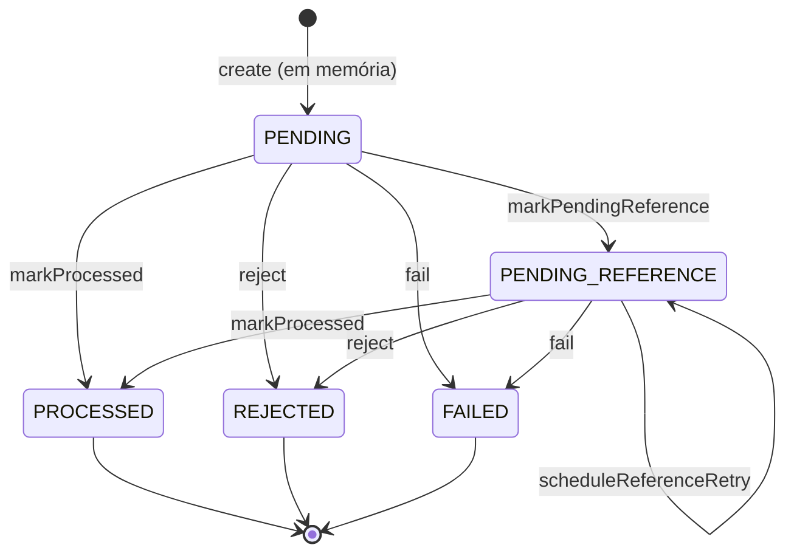

# Architecture

> Documento vivo: cada decisão é registrada no momento em que é tomada, durante o desenvolvimento.
>
> Formato de cada decisão:
> - **Decisão:**
> - **Alternativas consideradas:**
> - **Por que escolhi:**
> - **Trade-offs / limitações:**

## 1. Visão geral

<!-- Resumo do sistema, principais componentes e fluxo HTTP/SQS → use case → banco → outbox → publicação. -->

### 1.1 Stack e ferramentas

Versões em uso: Bun 1.4, TypeScript 7 (modo estrito), NestJS 12, MikroORM 7, PostgreSQL 17.

Antes de qualquer código de domínio, um spike validou que a stack funciona junta: NestJS subindo no Bun com injeção de dependências por decorators, MikroORM conectando no PostgreSQL, CLI de migrations rodando no Bun, migration reversível (`up`/`down`) e testes com `bun test`.

#### Adaptador HTTP do NestJS

- **Decisão:** Express.
- **Alternativas consideradas:** Fastify.
- **Por que escolhi:** é o adaptador padrão do NestJS. O gargalo deste sistema é o banco (locks e transações), não o framework HTTP, então o ganho de desempenho do Fastify não compensa.
- **Trade-offs / limitações:** menor throughput HTTP bruto que o Fastify.

#### Emulador de SQS

- **Decisão:** LocalStack com a versão fixada em `4.14.0`.
- **Alternativas consideradas:** LocalStack mais recente (2026.x) com `LOCALSTACK_AUTH_TOKEN`; MiniStack (alternativa open source citada no case).
- **Por que escolhi:** as versões atuais do LocalStack só sobem com token de licença, o que obrigaria qualquer pessoa que rode o projeto a criar uma conta. A `4.14.0` é a última que roda sem token. Optei pelo LocalStack por ser mais conhecido, por eu já ter experiência com ele (diferente do MiniStack) e por ser o primeiro citado no case.
- **Trade-offs / limitações:** a versão fica congelada, sem atualizações nem correções. Para um case técnico isso não é um problema, mas em um projeto que vai para produção o ideal seria usar as versões atuais. Se for preciso atualizar no futuro, basta trocar a imagem no `docker-compose.yml`.

#### Configuração

- **Decisão:** variáveis de ambiente lidas e validadas no boot por um loader tipado (`src/config/app-config.ts`), com valores padrão apontando para o ambiente local. Valor inválido ou ausente impede a aplicação de subir.
- **Alternativas consideradas:** `@nestjs/config`.
- **Por que escolhi:** poucas variáveis; um loader simples evita uma dependência e mantém a configuração tipada.
- **Trade-offs / limitações:** sem recursos como múltiplos arquivos `.env` por ambiente.

#### Execução das migrations

- **Decisão (provisória):** migrations rodam por comando separado (`bun run db:migrate`), não no boot da aplicação.
- **Alternativas consideradas:** rodar as migrations automaticamente ao subir a aplicação.
- **Por que escolhi:** com várias instâncias subindo ao mesmo tempo, todas tentariam migrar o banco simultaneamente.
- **Trade-offs / limitações:** exige um passo a mais no setup. A decisão pode ser revista quando a forma de rodar múltiplas instâncias for definida.

## 2. Estrutura do código e boundaries

<!-- Camadas (domínio, aplicação, infraestrutura, interfaces), portas e adapters. -->

## 3. Escopo e decisões de fora do escopo

Ficaram fora do escopo, por decisão, para concentrar o prazo nas áreas que mais pesam na avaliação (correção financeira, concorrência, idempotência e mensageria):

| Item | Status no case | Motivo |
|---|---|---|
| Autenticação real com IdP | Não pontua; pode ser só documentada | Ver seção 4 |
| Teste de carga | Diferencial opcional | Prazo |
| Ledger de partidas dobradas | Diferencial opcional | Prazo; o ledger simples atende às invariantes exigidas |
| OpenTelemetry / dashboard | Opcional | Prazo; logs estruturados, métricas e health checks cobrem o obrigatório |
| CI | Não pedido | Prazo |

## 4. Autenticação

- **Decisão:** não implementar autenticação neste desafio; deixar o ponto de extensão explícito no código.
- **Alternativas consideradas:** integrar um Identity Provider externo (Keycloak ou Zitadel) via OIDC.
- **Por que escolhi:** autenticação não vale pontos na avaliação e competiria em tempo com correção financeira, concorrência e idempotência, como o próprio case orienta.
- **Trade-offs / limitações:** a API fica aberta.

**Ponto de extensão no código:**
- `AuthGuard` (`src/auth/auth.guard.ts`), registrado como guard global: hoje libera todas as requisições. Uma implementação real validaria aqui o token emitido pelo IdP.
- Decorator `@Public()` (`src/auth/public.decorator.ts`): marca rotas que não exigem autenticação. Já aplicado aos health checks, que o case exige abertos.
- Mensagens da fila são tratadas como canal interno confiável, mas a identidade do provedor contida na mensagem continua sujeita às validações de domínio.

<!-- Desenho que seria adotado com um IdP externo: a definir. -->

## 5. Money

- **Decisão:** `bigint` em centavos no código e `numeric(20,2)` no banco, com entrada estrita de exatamente 2 casas decimais.
- **Alternativas consideradas:**
  - no código: biblioteca decimal (`decimal.js` / `big.js`);
  - no banco: coluna `bigint` com o valor em centavos.
- **Por que escolhi:**
  - `bigint` é nativo, exato para qualquer tamanho e não se mistura com `number` por acidente. Como a entrada tem exatamente 2 casas e as operações são somas, subtrações e comparações, não há necessidade de controle de arredondamento, então uma dependência como `decimal.js` não se justifica.
  - `numeric(20,2)` no banco é exato e mantém os valores legíveis em consultas, o que facilita auditoria e investigação de divergências. As constraints (`balance >= 0`) e a soma da reconciliação (`SUM`) também ficam exatas e claras.
  - A entrada estrita segue o case ("sempre com escala fixa de 2 casas") e garante uma única representação para cada valor. Assim, o mesmo valor nunca gera `payloadHash` diferentes por estar escrito de formas diferentes (`"25"`, `"25.0"`, `"25.00"`).
- **Regras de validação da entrada:** o formato aceito é apenas inteiro seguido de exatamente 2 casas decimais (ex.: `"25.00"`). São rejeitados: string vazia, notação científica (`"1e3"`), `NaN`, `Infinity`, sinal negativo, menos ou mais de 2 casas (`"25"`, `"25.5"`, `"25.001"`) e valores acima do máximo suportado.
- **Negativos:** a entrada nunca aceita valores negativos, mas o `Money` pode representá-los internamente (`negate()`, `isNegative()`), por exemplo como resultado de uma subtração. Quem garante que o saldo nunca fica negativo é a `Wallet` (e o banco, via constraint), não o `Money`.
- **Trade-offs / limitações:**
  - Exige conversão string ↔ `bigint` nas fronteiras (API e banco), porque JSON não suporta `bigint` e o driver retorna `numeric` como string.
  - A formatação para exibição é manual.
  - Escala fixa de 2 casas para todas as moedas: moedas com outra escala (ex.: JPY com 0, BHD com 3) não são suportadas. O case permite assumir uma única moeda (BRL); o modelo continua multimoeda e conflitos de moeda são rejeitados.
  - O `bigint` não tem limite, mas o `numeric(20,2)` tem. Por isso o `Money` valida um valor máximo, para que um valor grande demais seja rejeitado no domínio e não estoure no banco.
  - Se surgirem percentuais, juros ou rateio, será preciso implementar o arredondamento ou rever a decisão.

## 6. Modelo de domínio

### 6.1 Transições de status de `WagerTransaction`

- **Decisão:** `PENDING` existe apenas em memória. A transação nasce `PENDING` no `create` e é resolvida dentro da mesma transação SQL; no banco só aparecem `PROCESSED`, `REJECTED`, `PENDING_REFERENCE` e `FAILED`.
- **Alternativas consideradas:** gravar `PENDING` primeiro e processar em uma segunda transação SQL.
- **Por que escolhi:** HTTP e SQS executam o mesmo use case de forma síncrona, então não há trabalho "aceito para depois" além do `PENDING_REFERENCE`. Gravar `PENDING` criaria um estado intermediário que poderia ficar preso se o processo morresse entre as duas transações, exigindo um mecanismo extra de recuperação.
- **Trade-offs / limitações:** não há registro de transações que falharam por erro transitório antes do commit; elas simplesmente não existem até uma nova tentativa ter sucesso (ver `FAILED` abaixo para erros permanentes).

| De | Para | Método | Quando | O que registra |
|---|---|---|---|---|
| `PENDING` ou `PENDING_REFERENCE` | `PROCESSED` | `markProcessed(referenceTransactionId?, balanceAfter, at)` | Todas as regras de negócio passaram | `processedAt`, `resolvedAt`, `balanceAfter`, `referenceTransactionId` (quando há referência) |
| `PENDING` ou `PENDING_REFERENCE` | `REJECTED` | `reject(code, balanceAfter, at)` | Regra de negócio violada, ou tentativas de resolver a referência esgotadas | `failureCode`, `resolvedAt`, `balanceAfter` |
| `PENDING` ou `PENDING_REFERENCE` | `FAILED` | `fail(code, at)` | Erro permanente de infraestrutura (ver abaixo) | `failureCode`, `resolvedAt` |
| `PENDING` | `PENDING_REFERENCE` | `markPendingReference(...)` | A referência informada não foi encontrada | Contador de tentativas e data da próxima tentativa |
| `PENDING_REFERENCE` | (mesmo status) | `scheduleReferenceRetry(now)` | Nova tentativa do worker sem encontrar a referência | Incrementa o contador e recalcula a próxima tentativa |

**Transições inválidas** lançam `InvalidTransactionStateError` (erro de programação, não caminho de negócio):
- qualquer transição a partir de `PROCESSED`, `REJECTED` ou `FAILED` (estados terminais);
- `markPendingReference` em uma transação que já está em `PENDING_REFERENCE`;
- `scheduleReferenceRetry` fora de `PENDING_REFERENCE`.

**Campos registrados nas transições:**
- `processedAt`: preenchido somente ao virar `PROCESSED`, como no modelo do case.
- `resolvedAt`: preenchido por qualquer transição para um estado terminal, para que toda transação finalizada tenha data de auditoria. Por isso `reject` e `fail` recebem a data, o que o esqueleto do case não previa.
- `balanceAfter`: saldo observado no momento da resolução, preenchido em `PROCESSED` (saldo após a operação; em `LOSS`, o saldo inalterado) e em `REJECTED` (saldo no momento da rejeição). Vazio em `PENDING_REFERENCE` e `FAILED`. É a fonte do saldo devolvido no replay (regra 7); o ledger não serve para isso, porque `LOSS` e `REJECTED` não geram lançamento.
- `referenceTransactionId`: preenchido somente em `PROCESSED`. Em uma rejeição ligada à referência, o rastro fica no `referenceExternalTransactionId` (sempre gravado, vindo do payload) e no `failureCode`.
- Tentativas de resolução da referência (contador e próxima tentativa): ficam na própria transação, sem tabela separada. Limite e backoff: ver seção 14.

**Quando uma transação vira `FAILED`:**
- **Decisão:** apenas quando o erro é classificado como permanente (não é de negócio e uma nova tentativa não resolveria) ou, na entrada por SQS, na última tentativa antes da DLQ. Como a transação SQL do processamento sofreu rollback, o `FAILED` é gravado em uma transação SQL separada.
- **Alternativas consideradas:** nunca gravar `FAILED` (deixando a DLQ como único registro); gravar `FAILED` em qualquer erro de infraestrutura.
- **Por que escolhi:** dá ao status um uso real e auditável sem "queimar" transações por instabilidades passageiras, que são tratadas com retry (503 na API, redelivery no SQS).
- **Trade-offs / limitações:** a transação `FAILED` mantém a idempotency key; repetir a mesma operação devolve `FAILED`, e o provedor precisa de uma nova key para tentar de novo.

### 6.2 Interpretações adicionais das regras de negócio

- **Inválido × rejeitado.** O que pode ser verificado apenas olhando o payload (campos ausentes, formato do `Money`, `kind` inexistente, `OPENING` vindo de fora, `Idempotency-Key` ausente, `REFUND`/`ROLLBACK` sem `referenceExternalTransactionId`) é **inválido**: responde 400 e nada é gravado. O que depende do estado no banco (saldo insuficiente, moeda diferente da wallet, referência de outro player/rodada, reversão duplicada, reversão que deixaria saldo negativo) é **rejeitado**: gravado como `REJECTED`, com `failureCode`, auditável e repetível. Payload inválido não tem estado a auditar e o provedor corrige o payload; rejeição precisa devolver sempre a mesma resposta (regra 7).
- **Referência ausente vale para qualquer tipo.** A regra 8 não distingue tipos: qualquer transação que informa `referenceExternalTransactionId` não encontrada vai para `PENDING_REFERENCE`, inclusive `WIN`. Ignorar uma referência informada pularia as validações da regra 2 (mesmo provider, player, wallet, moeda e rodada). Um `WIN` sem referência é processado normalmente.
- **Replay de transação pendente.** A regra 7 fala de operação já processada. Para uma transação que está (ou esteve) em `PENDING_REFERENCE`, o replay devolve o **estado atual** com `idempotentReplay: true`: 202 enquanto pendente; o resultado final (com o `balanceAfter` gravado) depois de resolvida. Assim o provedor pode repetir a chamada para saber o desfecho.
- **`OPENING`.** Segue o mesmo ciclo (`PENDING` → `PROCESSED`), na mesma transação SQL que cria a wallet, e nunca é rejeitada nem fica pendente. Por ser interna, não tem campos de provedor (`providerId`, `externalTransactionId`, `idempotencyKey`, `roundId`, `gameId`): essas colunas aceitam nulo **somente** quando `kind = 'OPENING'`, garantido por `CHECK` no banco, e um índice único garante no máximo um `OPENING` por wallet. Alternativa descartada: valores reservados (ex.: `providerId = "system"`), que exigiriam bloquear esses valores na API e criariam um provedor fictício.
- **Wallet inexistente não é gravada.** Exceção à regra "o que depende do banco é gravado": a transação referencia a wallet por chave estrangeira, então não é possível gravá-la apontando para uma wallet que não existe. A resposta é 422 `WALLET_NOT_FOUND`, sem gravação; sem wallet não há estado a auditar, e a integridade referencial no banco é preservada. Já uma wallet existente que não pertence ao `playerId` informado gera `REJECTED` com `PLAYER_WALLET_MISMATCH`.
- **Referência que não está `PROCESSED`.** A regra 3 exige que a referência seja `PROCESSED`. Se ela existe em qualquer outro estado (`REJECTED`, `FAILED` ou `PENDING_REFERENCE`), a nova transação é rejeitada com `REFERENCE_NOT_PROCESSED`, sem espera. Ver limitação na seção 18.
- **Reversão única no total.** A regra 4 diz que uma referência não pode ser revertida duas vezes "pelo mesmo tipo de operação". Lida literalmente, uma `BET` poderia receber um `REFUND` e um `ROLLBACK`, creditando o valor duas vezes, o que viola a invariante global de não duplicar créditos. Por isso, uma transação só pode ser revertida **uma vez no total**, por `REFUND` ou `ROLLBACK`; a segunda tentativa é rejeitada com `ALREADY_REVERSED`. Um `ROLLBACK` de um `REFUND` continua permitido, porque reverte outra transação. No banco, a unicidade é garantida por um índice único sobre a referência (não sobre referência + tipo) entre as reversões processadas.

## 7. ORM e mapeamento de persistência

### 7.1 Escolha do ORM

- **Decisão:** MikroORM.
- **Alternativas consideradas:** TypeORM (aceito pelo case).
- **Por que escolhi:** é o preferencial do case e oferece Unit of Work, Identity Map, `em.transactional()` e `LockMode` explícitos, recursos diretamente ligados às exigências de atomicidade e concorrência.
- **Trade-offs / limitações:** <!-- a definir -->

### 7.2 Mapeamento domínio × ORM

<!-- A decidir na etapa 3. -->

**Observação do spike:** uma classe com construtor `private` e sem decorators pode ser mapeada via `EntitySchema`. Em runtime funciona (o ORM reidrata sem chamar o construtor), mas o TypeScript recusa o construtor privado no `EntitySchema`, o que exige um cast (`as unknown as EntityCtor<T>`) em cada entidade.

**Observação sobre migrations:** a migration gerada com `--initial` não inclui `down`; as geradas a partir de diferenças no schema incluem. Como o case exige migrations reversíveis, todo `down` é conferido.

**Mapeamento do Money:** ver seção 5 (`numeric(20,2)` + coluna de moeda, convertido de/para `bigint` na reidratação).

<!-- Estratégia transacional: a definir. -->

## 8. Schema, constraints e índices

<!-- Como cada garantia da seção 6 do case é aplicada no banco. -->

## 9. Concorrência

## 10. Idempotência

<!-- Fluxo, replay, conflito, algoritmo do payloadHash. -->

## 11. API HTTP

### 11.1 Mapeamento de status HTTP

### 11.2 Taxonomia de `failureCode`

- **Decisão:** códigos em inglês, `UPPER_SNAKE_CASE`, definidos em um enum. Um código publicado nunca muda de significado. Cada código pertence a uma categoria fixa, e a categoria é comunicada pelo status HTTP. Há uma lista única para todas as respostas de erro da API; apenas os códigos de `REJECTED` e `FAILED` ficam gravados na transação.
- **Alternativas consideradas:** códigos numéricos (`E1001`); campo `retryable` na resposta; `failureCode` apenas para transações gravadas, com os demais erros respondendo só com mensagem.
- **Por que escolhi:** códigos textuais se explicam sozinhos em logs e no JSON, e o enum impede códigos fora da lista em tempo de compilação. O status HTTP já distingue as categorias (exigência do case), então um campo `retryable` seria redundante e poderia contradizê-lo. Uma lista única permite ao provedor decidir o que fazer com qualquer erro sem interpretar mensagens.
- **Trade-offs / limitações:** adicionar um código é compatível; mudar o significado de um existente não é, e exigiria um código novo.

> Os status HTTP abaixo indicam a categoria; o mapeamento definitivo é documentado na seção 11.1.

| Categoria | O que o provedor faz | HTTP | Gravado? | Códigos |
|---|---|---|---|---|
| Payload inválido | Corrige o payload | 400 | Não | `INVALID_PAYLOAD`, `INVALID_MONEY`, `INVALID_KIND`, `MISSING_REFERENCE`, `MISSING_IDEMPOTENCY_KEY` |
| Conflito | Não repete a requisição | 409 | Não | `IDEMPOTENCY_CONFLICT`, `EXTERNAL_TRANSACTION_CONFLICT`, `WALLET_ALREADY_EXISTS` |
| Não encontrado | Corrige o identificador | 404 (recurso da URL) / 422 (citado no corpo) | Não | `WALLET_NOT_FOUND`, `TRANSACTION_NOT_FOUND` |
| Rejeição de negócio | Desiste ou corrige | 422 | Sim (`REJECTED`) | `INSUFFICIENT_FUNDS`, `REVERSAL_INSUFFICIENT_FUNDS`, `CURRENCY_MISMATCH`, `PLAYER_WALLET_MISMATCH`, `REFERENCE_NOT_FOUND`, `REFERENCE_MISMATCH`, `INVALID_REFERENCE_KIND`, `REFERENCE_NOT_PROCESSED`, `ALREADY_REVERSED`, `AMOUNT_MISMATCH` |
| Falha transitória | Reenvia (com backoff) | 503 | Não | `TEMPORARILY_UNAVAILABLE` |
| Falha permanente | Investiga; reenviar com a mesma key devolve o mesmo resultado | 500 | Sim (`FAILED`) | `PROCESSING_FAILED` |

| Código | Significado |
|---|---|
| `INVALID_PAYLOAD` | Campo obrigatório ausente ou com tipo inválido |
| `INVALID_MONEY` | Valor monetário fora do formato (escala diferente de 2 casas, notação científica, negativo, `NaN`, `Infinity`, vazio ou acima do máximo) |
| `INVALID_KIND` | Tipo de operação inexistente, ou `OPENING` submetido externamente |
| `MISSING_REFERENCE` | `REFUND` ou `ROLLBACK` sem `referenceExternalTransactionId` |
| `MISSING_IDEMPOTENCY_KEY` | Header `Idempotency-Key` ausente |
| `IDEMPOTENCY_CONFLICT` | Mesma idempotency key com payload diferente |
| `EXTERNAL_TRANSACTION_CONFLICT` | Mesmo `(providerId, externalTransactionId)` de uma transação existente, com outra idempotency key |
| `WALLET_ALREADY_EXISTS` | Já existe wallet para o mesmo `playerId` + `currency` |
| `WALLET_NOT_FOUND` | Wallet inexistente |
| `TRANSACTION_NOT_FOUND` | Transação inexistente |
| `INSUFFICIENT_FUNDS` | Aposta (`BET`) sem saldo suficiente |
| `REVERSAL_INSUFFICIENT_FUNDS` | Reversão que deixaria o saldo negativo (distinto de `INSUFFICIENT_FUNDS`, como exige a regra 9) |
| `CURRENCY_MISMATCH` | Moeda da operação diferente da moeda da wallet |
| `PLAYER_WALLET_MISMATCH` | A wallet existe, mas não pertence ao `playerId` informado |
| `REFERENCE_NOT_FOUND` | Referência não encontrada após esgotar as tentativas de `PENDING_REFERENCE` |
| `REFERENCE_MISMATCH` | Referência de outro provider, player, wallet, moeda ou rodada (o campo divergente vai para o log) |
| `INVALID_REFERENCE_KIND` | Tipo de referência não permitido (`REFUND` só referencia `BET`; `ROLLBACK` só referencia `BET`, `WIN` ou `REFUND`) |
| `REFERENCE_NOT_PROCESSED` | A referência existe, mas não está `PROCESSED` |
| `ALREADY_REVERSED` | A referência já foi revertida (por `REFUND` ou `ROLLBACK`) |
| `AMOUNT_MISMATCH` | Valor da reversão diferente do valor da referência |
| `TEMPORARILY_UNAVAILABLE` | Banco ou fila indisponível, ou timeout de lock |
| `PROCESSING_FAILED` | Erro permanente de infraestrutura; transação gravada como `FAILED` |

## 12. Processamento por SQS

<!-- Inbox, ack, classificação de erros, retry, DLQ, shutdown. -->

## 13. Transactional Outbox

## 14. Referências fora de ordem (`PENDING_REFERENCE`)

## 15. Reconciliação

## 16. Observabilidade

### 16.1 Logs estruturados

- **Decisão:** `pino` via `nestjs-pino`, com saída em JSON.
- **Alternativas consideradas:** `winston`; estender o logger nativo do NestJS para gerar JSON.
- **Por que escolhi:** JSON nativo; o `nestjs-pino` propaga o contexto da requisição (via `AsyncLocalStorage`) para todos os logs gerados durante ela, sem passar o logger manualmente.
- **Trade-offs / limitações:** a saída em JSON é pouco legível no terminal durante o desenvolvimento (pode ser contornado com `pino-pretty`, não incluído).

**Como está configurado:**
- **`correlationId`:** reutiliza o header `x-correlation-id` da requisição, ou gera um UUID. É devolvido no mesmo header da resposta e aparece em todos os logs da requisição.
- **Sem dados sensíveis:** o log da requisição registra só método e URL, e o da resposta só o status. Headers `authorization` e `cookie` são removidos (`redact`), e corpos de requisição e resposta (payloads financeiros) não são logados.
- Requisições aos health checks não geram log de acesso, para não poluir os logs com as sondagens.

<!-- messageId, transactionId, walletId, providerId: a adicionar com o use case e o consumidor SQS. -->

### 16.2 Health checks

- `GET /health/live`: indica que o processo está de pé e respondendo. Não consulta dependências, para que uma falha no banco ou na fila não faça o orquestrador reiniciar o processo à toa.
- `GET /health/ready`: verifica o PostgreSQL (`select 1`) e o SQS (`GetQueueUrl` da fila principal), cada um com timeout de 2 s. Responde 200 se ambos estiverem acessíveis e 503 caso contrário, indicando qual dependência falhou. O motivo da falha é registrado no log.
- Os dois são públicos (`@Public()`), como o case exige.

### 16.3 Métricas

<!-- A definir. -->

## 17. Testes

<!-- Estratégia, como cada cenário obrigatório é exercitado, determinismo. -->

## 18. Trade-offs e limitações conhecidas

- **Reversão de transação ainda pendente.** Uma reversão que chega enquanto a transação referenciada está em `PENDING_REFERENCE` é rejeitada com `REFERENCE_NOT_PROCESSED`, em vez de aguardar a resolução da referência. Encadear pendências não é exigido pelo case e adicionaria complexidade ao worker; o caso é raro (exige duas operações fora de ordem em sequência).

## 19. Uso de IA

<!-- Para que foi usada e como o conteúdo foi validado. -->
