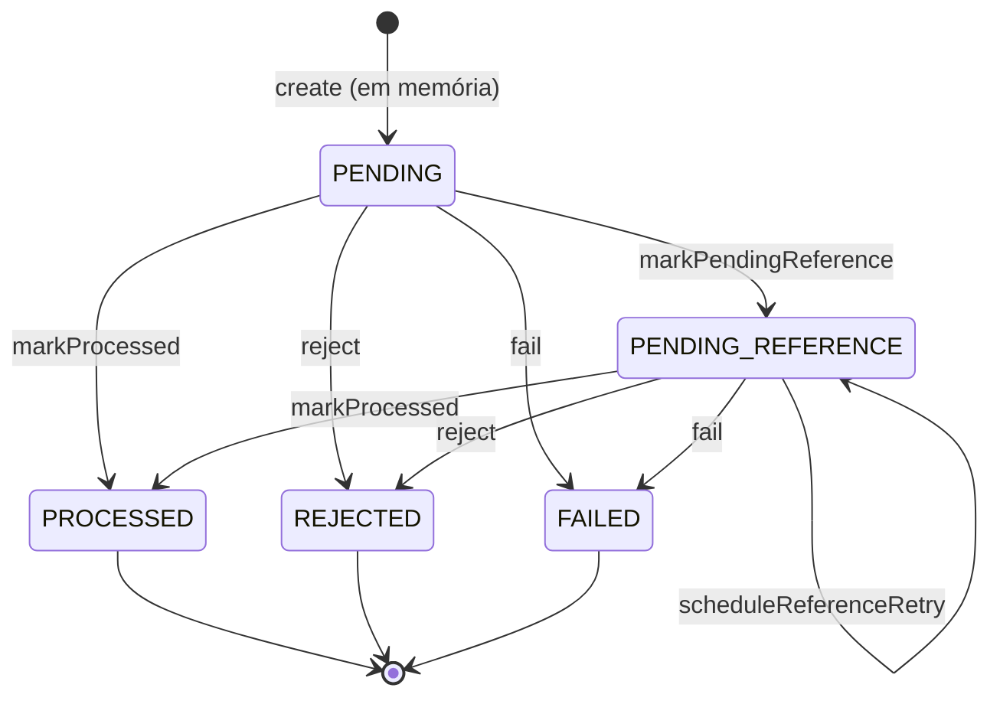

# Architecture

> Documento vivo: cada decisão é registrada no momento em que é tomada, durante o desenvolvimento.
>
> Formato de cada decisão:
> - **Decisão:**
> - **Alternativas consideradas:**
> - **Por que escolhi:**
> - **Trade-offs / limitações:**

## 1. Visão geral

<!-- Resumo do sistema, principais componentes e fluxo HTTP/SQS → use case → banco → outbox → publicação. -->

### 1.1 Stack e ferramentas

Versões em uso: Bun 1.4, TypeScript 7 (modo estrito), NestJS 12, MikroORM 7, PostgreSQL 17.

Antes de qualquer código de domínio, um spike validou que a stack funciona junta: NestJS subindo no Bun com injeção de dependências por decorators, MikroORM conectando no PostgreSQL, CLI de migrations rodando no Bun, migration reversível (`up`/`down`) e testes com `bun test`.

#### Adaptador HTTP do NestJS

- **Decisão:** Express.
- **Alternativas consideradas:** Fastify.
- **Por que escolhi:** é o adaptador padrão do NestJS. O gargalo deste sistema é o banco (locks e transações), não o framework HTTP, então o ganho de desempenho do Fastify não compensa.
- **Trade-offs / limitações:** menor throughput HTTP bruto que o Fastify.

#### Emulador de SQS

- **Decisão:** LocalStack com a versão fixada em `4.14.0`.
- **Alternativas consideradas:** LocalStack mais recente (2026.x) com `LOCALSTACK_AUTH_TOKEN`; MiniStack (alternativa open source citada no case).
- **Por que escolhi:** as versões atuais do LocalStack só sobem com token de licença, o que obrigaria qualquer pessoa que rode o projeto a criar uma conta. A `4.14.0` é a última que roda sem token. Optei pelo LocalStack por ser mais conhecido, por eu já ter experiência com ele (diferente do MiniStack) e por ser o primeiro citado no case.
- **Trade-offs / limitações:** a versão fica congelada, sem atualizações nem correções. Para um case técnico isso não é um problema, mas em um projeto que vai para produção o ideal seria usar as versões atuais. Se for preciso atualizar no futuro, basta trocar a imagem no `docker-compose.yml`.

#### Configuração

- **Decisão:** variáveis de ambiente lidas e validadas no boot por um loader tipado (`src/config/app-config.ts`), com valores padrão apontando para o ambiente local. Valor inválido ou ausente impede a aplicação de subir.
- **Alternativas consideradas:** `@nestjs/config`.
- **Por que escolhi:** poucas variáveis; um loader simples evita uma dependência e mantém a configuração tipada.
- **Trade-offs / limitações:** sem recursos como múltiplos arquivos `.env` por ambiente.

#### Execução das migrations

- **Decisão (provisória):** migrations rodam por comando separado (`bun run db:migrate`), não no boot da aplicação.
- **Alternativas consideradas:** rodar as migrations automaticamente ao subir a aplicação.
- **Por que escolhi:** com várias instâncias subindo ao mesmo tempo, todas tentariam migrar o banco simultaneamente.
- **Trade-offs / limitações:** exige um passo a mais no setup. A decisão pode ser revista quando a forma de rodar múltiplas instâncias for definida.

## 2. Estrutura do código e boundaries

- **Decisão:** DDD tático com portas e adaptadores (arquitetura hexagonal), organizado **por camada**.
- **Alternativas consideradas:**
  - CQRS formal (comandos, queries e handlers separados, `@nestjs/cqrs`);
  - versão mais leve, com use cases usando o `EntityManager` diretamente, sem interfaces de repositório;
  - organização por módulo (`wallet/`, `wagering/`), com camadas dentro de cada um.
- **Por que escolhi:** o case pede os padrões táticos do DDD (value object `Money`, aggregate root `Wallet`, entidades com transições explícitas, factories e `rehydrate`) e avalia "boundaries, portas e simplicidade". Portas e adaptadores mantêm o domínio isolado de NestJS e MikroORM sem acrescentar camadas que nenhuma regra exige, como o CQRS formal. DDD estratégico (bounded contexts, mapas de contexto) não se justifica em um sistema deste tamanho. A organização por camada foi preferida porque o use case central altera wallet, transação, ledger e outbox na mesma transação SQL: separar em módulos geraria imports cruzados constantes, sem uma fronteira real entre eles.
- **Trade-offs / limitações:** se o sistema crescesse para vários contextos independentes, a organização por módulo passaria a fazer mais sentido.

```
src/
  domain/          regras de negócio puras: Money, Wallet, WagerTransaction,
                   WalletLedgerEntry, Inbox/Outbox, eventos de integração, erros de domínio
  application/     use cases (orquestram uma transação SQL), portas
                   (interfaces de repositórios, publisher, relógio etc.) e
                   services (regras compartilhadas entre use cases) e
                   queries (leituras sem efeito, num snapshot só)
  infrastructure/  adaptadores: persistence (MikroORM), messaging (SQS),
                   http (controllers, health, auth), validation (schemas
                   compartilhados por HTTP e fila), workers (loops de
                   polling do publisher e do PENDING_REFERENCE), config
  main.ts, app.module.ts
```

**Regra de dependência:** `infrastructure → application → domain`. O domínio não importa nada de fora dele, nem `@nestjs/*`, nem `@mikro-orm/*`. A regra é verificada por um teste automático (`test/architecture.test.ts`), que falha se algum arquivo de `src/domain/` importar esses pacotes ou as outras camadas.

**Erros de domínio:** uma classe base abstrata `DomainError` carrega um `code: FailureCode` (seção 11.2), com uma subclasse por situação (ex.: `InvalidMoneyError` → `INVALID_MONEY`). A camada HTTP converte qualquer `DomainError` em resposta pelo `code`, sem conhecer cada erro. O `InvalidTransactionStateError` fica **fora** dessa hierarquia: é erro de programação, não regra de negócio, e resulta em 500. Também ficam fora os erros internos que nunca chegam ao provedor e só são tratados por quem os conhece: `DuplicateIdempotencyKeyError` (seção 9.5) e `InboxMessageConflictError` (seção 12.1).

**Testes:** os de unidade ficam ao lado do código (`*.test.ts` em `src/`); os de integração, concorrência e e2e, que precisam de infraestrutura rodando, ficam em `test/`.

## 3. Escopo e decisões de fora do escopo

Ficaram fora do escopo, por decisão, para concentrar o prazo nas áreas que mais pesam na avaliação (correção financeira, concorrência, idempotência e mensageria):

| Item | Status no case | Motivo |
|---|---|---|
| Autenticação real com IdP | Não pontua; pode ser só documentada | Ver seção 4 |
| Teste de carga | Diferencial opcional | Prazo |
| Ledger de partidas dobradas | Diferencial opcional | Prazo; o ledger simples atende às invariantes exigidas |
| OpenTelemetry / dashboard | Opcional | Prazo; logs estruturados, métricas e health checks cobrem o obrigatório |
| CI | Não pedido | Prazo |

## 4. Autenticação

- **Decisão:** não implementar autenticação neste desafio; deixar o ponto de extensão explícito no código.
- **Alternativas consideradas:** integrar um Identity Provider externo (Keycloak ou Zitadel) via OIDC.
- **Por que escolhi:** autenticação não vale pontos na avaliação e competiria em tempo com correção financeira, concorrência e idempotência, como o próprio case orienta.
- **Trade-offs / limitações:** a API fica aberta.

**Ponto de extensão no código:**
- `AuthGuard` (`src/auth/auth.guard.ts`), registrado como guard global: hoje libera todas as requisições. Uma implementação real validaria aqui o token emitido pelo IdP.
- Decorator `@Public()` (`src/auth/public.decorator.ts`): marca rotas que não exigem autenticação. Já aplicado aos health checks, que o case exige abertos.
- Mensagens da fila são tratadas como canal interno confiável, mas a identidade do provedor contida na mensagem continua sujeita às validações de domínio.

<!-- Desenho que seria adotado com um IdP externo: a definir. -->

## 5. Money

- **Decisão:** `bigint` em centavos no código e `numeric(20,2)` no banco, com entrada estrita de exatamente 2 casas decimais.
- **Alternativas consideradas:**
  - no código: biblioteca decimal (`decimal.js` / `big.js`);
  - no banco: coluna `bigint` com o valor em centavos.
- **Por que escolhi:**
  - `bigint` é nativo, exato para qualquer tamanho e não se mistura com `number` por acidente. Como a entrada tem exatamente 2 casas e as operações são somas, subtrações e comparações, não há necessidade de controle de arredondamento, então uma dependência como `decimal.js` não se justifica.
  - `numeric(20,2)` no banco é exato e mantém os valores legíveis em consultas, o que facilita auditoria e investigação de divergências. As constraints (`balance >= 0`) e a soma da reconciliação (`SUM`) também ficam exatas e claras.
  - A entrada estrita segue o case ("sempre com escala fixa de 2 casas") e garante uma única representação para cada valor. Assim, o mesmo valor nunca gera `payloadHash` diferentes por estar escrito de formas diferentes (`"25"`, `"25.0"`, `"25.00"`).
- **Regras de validação da entrada:** o formato aceito é apenas inteiro seguido de exatamente 2 casas decimais (ex.: `"25.00"`). São rejeitados: string vazia, notação científica (`"1e3"`), `NaN`, `Infinity`, sinal negativo, menos ou mais de 2 casas (`"25"`, `"25.5"`, `"25.001"`) e valores acima do máximo suportado.
- **Negativos:** a entrada nunca aceita valores negativos, mas o `Money` pode representá-los internamente (`negate()`, `isNegative()`), por exemplo como resultado de uma subtração. Quem garante que o saldo nunca fica negativo é a `Wallet` (e o banco, via constraint), não o `Money`.
- **Trade-offs / limitações:**
  - Exige conversão string ↔ `bigint` nas fronteiras (API e banco), porque JSON não suporta `bigint` e o driver retorna `numeric` como string.
  - A formatação para exibição é manual.
  - Escala fixa de 2 casas para todas as moedas: moedas com outra escala (ex.: JPY com 0, BHD com 3) não são suportadas. O case permite assumir uma única moeda (BRL); o modelo continua multimoeda e conflitos de moeda são rejeitados.
  - O `bigint` não tem limite, mas o `numeric(20,2)` tem. Por isso o `Money` valida um valor máximo, para que um valor grande demais seja rejeitado no domínio e não estoure no banco.
  - Se surgirem percentuais, juros ou rateio, será preciso implementar o arredondamento ou rever a decisão.

## 6. Modelo de domínio

### 6.1 Transições de status de `WagerTransaction`

- **Decisão:** `PENDING` existe apenas em memória. A transação nasce `PENDING` no `create` e é resolvida dentro da mesma transação SQL; no banco só aparecem `PROCESSED`, `REJECTED`, `PENDING_REFERENCE` e `FAILED`.
- **Alternativas consideradas:** gravar `PENDING` primeiro e processar em uma segunda transação SQL.
- **Por que escolhi:** HTTP e SQS executam o mesmo use case de forma síncrona, então não há trabalho "aceito para depois" além do `PENDING_REFERENCE`. Gravar `PENDING` criaria um estado intermediário que poderia ficar preso se o processo morresse entre as duas transações, exigindo um mecanismo extra de recuperação.
- **Trade-offs / limitações:** não há registro de transações que falharam por erro transitório antes do commit; elas simplesmente não existem até uma nova tentativa ter sucesso (ver `FAILED` abaixo para erros permanentes).



| De | Para | Método | Quando | O que registra |
|---|---|---|---|---|
| `PENDING` ou `PENDING_REFERENCE` | `PROCESSED` | `markProcessed(referenceTransactionId?, balanceAfter, at)` | Todas as regras de negócio passaram | `processedAt`, `resolvedAt`, `balanceAfter`, `referenceTransactionId` (quando há referência) |
| `PENDING` ou `PENDING_REFERENCE` | `REJECTED` | `reject(code, balanceAfter, at)` | Regra de negócio violada, ou tentativas de resolver a referência esgotadas | `failureCode`, `resolvedAt`, `balanceAfter` |
| `PENDING` ou `PENDING_REFERENCE` | `FAILED` | `fail(code, at)` | Erro permanente de infraestrutura (ver abaixo) | `failureCode`, `resolvedAt` |
| `PENDING` | `PENDING_REFERENCE` | `markPendingReference(...)` | A referência informada não foi encontrada | Contador de tentativas e data da próxima tentativa |
| `PENDING_REFERENCE` | (mesmo status) | `scheduleReferenceRetry(now)` | Nova tentativa do worker sem encontrar a referência | Incrementa o contador e recalcula a próxima tentativa |

**Transições inválidas** lançam `InvalidTransactionStateError` (erro de programação, não caminho de negócio):
- qualquer transição a partir de `PROCESSED`, `REJECTED` ou `FAILED` (estados terminais);
- `markPendingReference` em uma transação que já está em `PENDING_REFERENCE`;
- `scheduleReferenceRetry` fora de `PENDING_REFERENCE`.

**Campos registrados nas transições:**
- `processedAt`: preenchido somente ao virar `PROCESSED`, como no modelo do case.
- `resolvedAt`: preenchido por qualquer transição para um estado terminal, para que toda transação finalizada tenha data de auditoria. Por isso `reject` e `fail` recebem a data, o que o esqueleto do case não previa.
- `balanceAfter`: saldo observado no momento da resolução, preenchido em `PROCESSED` (saldo após a operação; em `LOSS`, o saldo inalterado) e em `REJECTED` (saldo no momento da rejeição). Vazio em `PENDING_REFERENCE` e `FAILED`. É a fonte do saldo devolvido no replay (regra 7); o ledger não serve para isso, porque `LOSS` e `REJECTED` não geram lançamento.
- `referenceTransactionId`: preenchido somente em `PROCESSED`. Em uma rejeição ligada à referência, o rastro fica no `referenceExternalTransactionId` (sempre gravado, vindo do payload) e no `failureCode`.
- Tentativas de resolução da referência (contador e próxima tentativa): ficam na própria transação, sem tabela separada. Limite e backoff: ver seção 14.

**Quando uma transação vira `FAILED`:**
- **Decisão:** apenas quando o erro é classificado como permanente (não é de negócio e uma nova tentativa não resolveria) ou, na entrada por SQS, na última tentativa antes da DLQ. Como a transação SQL do processamento sofreu rollback, o `FAILED` é gravado em uma transação SQL separada.
- **Alternativas consideradas:** nunca gravar `FAILED` (deixando a DLQ como único registro); gravar `FAILED` em qualquer erro de infraestrutura.
- **Por que escolhi:** dá ao status um uso real e auditável sem "queimar" transações por instabilidades passageiras, que são tratadas com retry (503 na API, redelivery no SQS).
- **Trade-offs / limitações:** a transação `FAILED` mantém a idempotency key; repetir a mesma operação devolve `FAILED`, e o provedor precisa de uma nova key para tentar de novo.

### 6.2 Interpretações adicionais das regras de negócio

- **Inválido × rejeitado.** O que pode ser verificado apenas olhando o payload (campos ausentes, formato do `Money`, `kind` inexistente, `OPENING` vindo de fora, `Idempotency-Key` ausente, `REFUND`/`ROLLBACK` sem `referenceExternalTransactionId`) é **inválido**: responde 400 e nada é gravado. O que depende do estado no banco (saldo insuficiente, moeda diferente da wallet, referência de outro player/rodada, reversão duplicada, reversão que deixaria saldo negativo) é **rejeitado**: gravado como `REJECTED`, com `failureCode`, auditável e repetível. Payload inválido não tem estado a auditar e o provedor corrige o payload; rejeição precisa devolver sempre a mesma resposta (regra 7).
- **Referência ausente vale para qualquer tipo.** A regra 8 não distingue tipos: qualquer transação que informa `referenceExternalTransactionId` não encontrada vai para `PENDING_REFERENCE`, inclusive `WIN`. Ignorar uma referência informada pularia as validações da regra 2 (mesmo provider, player, wallet, moeda e rodada). Um `WIN` sem referência é processado normalmente.
- **Replay de transação pendente.** A regra 7 fala de operação já processada. Para uma transação que está (ou esteve) em `PENDING_REFERENCE`, o replay devolve o **estado atual** com `idempotentReplay: true`: 202 enquanto pendente; o resultado final (com o `balanceAfter` gravado) depois de resolvida. Assim o provedor pode repetir a chamada para saber o desfecho.
- **`OPENING`.** Segue o mesmo ciclo (`PENDING` → `PROCESSED`), na mesma transação SQL que cria a wallet, e nunca é rejeitada nem fica pendente. Por ser interna, não tem campos de provedor (`providerId`, `externalTransactionId`, `idempotencyKey`, `roundId`, `gameId`): essas colunas aceitam nulo **somente** quando `kind = 'OPENING'`, garantido por `CHECK` no banco, e um índice único garante no máximo um `OPENING` por wallet. Alternativa descartada: valores reservados (ex.: `providerId = "system"`), que exigiriam bloquear esses valores na API e criariam um provedor fictício.
- **Wallet inexistente não é gravada.** Exceção à regra "o que depende do banco é gravado": a transação referencia a wallet por chave estrangeira, então não é possível gravá-la apontando para uma wallet que não existe. A resposta é 422 `WALLET_NOT_FOUND`, sem gravação; sem wallet não há estado a auditar, e a integridade referencial no banco é preservada. Já uma wallet existente que não pertence ao `playerId` informado gera `REJECTED` com `PLAYER_WALLET_MISMATCH`.
- **Referência que não está `PROCESSED`.** A regra 3 exige que a referência seja `PROCESSED`. Se ela existe em qualquer outro estado (`REJECTED`, `FAILED` ou `PENDING_REFERENCE`), a nova transação é rejeitada com `REFERENCE_NOT_PROCESSED`, sem espera. Ver limitação na seção 18.
- **Reversão única no total.** A regra 4 diz que uma referência não pode ser revertida duas vezes "pelo mesmo tipo de operação". Lida literalmente, uma `BET` poderia receber um `REFUND` e um `ROLLBACK`, creditando o valor duas vezes, o que viola a invariante global de não duplicar créditos. Por isso, uma transação só pode ser revertida **uma vez no total**, por `REFUND` ou `ROLLBACK`; a segunda tentativa é rejeitada com `ALREADY_REVERSED`. Um `ROLLBACK` de um `REFUND` continua permitido, porque reverte outra transação. No banco, a unicidade é garantida por um índice único sobre a referência (não sobre referência + tipo) entre as reversões processadas.

- **Ordem das verificações.** Quando mais de uma regra se aplica, vale a primeira desta lista:
  1. `CURRENCY_MISMATCH`, depois `PLAYER_WALLET_MISMATCH` (`WagerTransaction.checkWallet`). A moeda vem primeiro porque `CURRENCY_MISMATCH` é o único código gravado sem saldo: o saldo da wallet está em outra moeda, e a linha tem uma única coluna de moeda. Uma transação com moeda e player divergentes não poderia ser gravada como `PLAYER_WALLET_MISMATCH`.
  2. Referência informada e não encontrada → `PENDING_REFERENCE`. As regras da wallet vêm antes para não deixar pendente uma transação que nunca vai poder passar.
  3. `REFERENCE_MISMATCH` → `INVALID_REFERENCE_KIND` → `REFERENCE_NOT_PROCESSED` → `AMOUNT_MISMATCH` (`WagerTransaction.checkReference`).
  4. `ALREADY_REVERSED`, só para `REFUND` e `ROLLBACK`.
  5. Saldo: `INSUFFICIENT_FUNDS` para `BET`; `REVERSAL_INSUFFICIENT_FUNDS` para um `ROLLBACK` que vira débito (regra 9).
- **`LOSS` grava o saldo atual.** Um `LOSS` é `PROCESSED` sem movimento e sem lançamento, e o `balance_after` registra o saldo observado naquele momento, para que o replay devolva o mesmo saldo (regra 7).
- **`WIN` com referência.** Um `WIN` pode referenciar a `BET` da rodada. A referência passa pelas mesmas validações de contexto, tipo e status, mas sem a exigência de valor igual (o prêmio não é o valor apostado), e o `WIN` não é uma reversão: a `BET` continua podendo receber um `REFUND`. Um `BET` ou `LOSS` com referência é rejeitado com `INVALID_REFERENCE_KIND`.

## 7. ORM e mapeamento de persistência

### 7.1 Escolha do ORM

- **Decisão:** MikroORM.
- **Alternativas consideradas:** TypeORM (aceito pelo case).
- **Por que escolhi:** é o preferencial do case e oferece Unit of Work, Identity Map, `em.transactional()` e `LockMode` explícitos, recursos diretamente ligados às exigências de atomicidade e concorrência.
- **Trade-offs / limitações:** <!-- a definir -->

### 7.2 Mapeamento domínio × ORM

- **Decisão:** modelos de persistência separados (`defineEntity` sem classe própria, com tipos inferidos) mais um mapper por agregado, que converte a linha do banco no `State` do domínio e usa o `rehydrate`. O Unit of Work continua em uso, só que sobre os modelos de persistência:
  - Agregado novo: o repositório faz `em.create` e `persist`.
  - Agregado alterado: o repositório pega a entidade gerenciada pelo identity map do `EntityManager` da requisição e aplica o estado do domínio com `em.assign`. O `flush` gera o `UPDATE` só das colunas que mudaram.
  - A atomicidade vem de `em.transactional`.
- **Alternativas consideradas:**
  - Mapear as classes de domínio direto no ORM (`defineEntity({ class })` ou `EntitySchema`): menos código, mas o ORM passa a determinar a forma das classes de domínio, e o construtor privado exige um cast por entidade.
  - Repositórios sem Unit of Work (`insert`/`nativeUpdate` explícitos): SQL totalmente visível, mas mais código de repositório.
- **Por que escolhi:**
  - O domínio já expõe `rehydrate(state)`, então o mapper é uma conversão direta.
  - O domínio fica livre do ORM, inclusive em forma, não só em imports.
  - O `defineEntity` é usado na forma recomendada, com inferência completa.
  - A conversão de `Money` fica explícita e testável.
  - É um padrão que já conheço.
- **Trade-offs:**
  - Cada agregado tem duas definições (domínio e persistência) mais um mapper.
  - Uma mudança em campo persistido exige ajustar o mapper.
  - A `version` da `Wallet` é incrementada pelo domínio e persistida como uma coluna comum, sem `version: true`, para não ser incrementada duas vezes. Ela não participa do controle de concorrência (seção 9.6).

**Observação do spike:** uma classe com construtor `private` e sem decorators pode ser mapeada via `EntitySchema`. Em runtime funciona (o ORM reidrata sem chamar o construtor), mas o TypeScript recusa o construtor privado no `EntitySchema`, o que exige um cast (`as unknown as EntityCtor<T>`) em cada entidade. Esse foi um dos motivos para usar modelos separados.

**Repositórios:** os ports ficam em `src/application/ports` e os adapters em `src/infrastructure/persistence/<agregado>`. O `save` só registra a mudança no Unit of Work; quem faz o `flush` é a transação do caso de uso. Um agregado carregado por outro `EntityManager` seria tratado como novo, e o banco recusaria a chave duplicada; com um `EntityManager` por requisição ou mensagem, isso não acontece.

**Mapeamento do Money:** ver seção 5. A coluna `numeric(20,2)` é lida como string decimal (`"75.00"`) e convertida por `Money.from`; na escrita, o mapper usa `money.toJSON().amount`. Não há `number` em nenhum ponto do caminho.

**Transação do caso de uso:** ver seção 9.2 (`UnitOfWork`).

### 7.3 Identificadores e relógio

- **Decisão:** ids gerados como UUIDv7 (`Bun.randomUUIDv7()`), por meio de dois ports da camada de aplicação: `IdGenerator` e `Clock`. O domínio continua recebendo `id` e `now` de fora.
- **Alternativas consideradas:** UUIDv4 (`randomUUID()`), gerado direto onde é usado.
- **Por que escolhi:** os exemplos do case são UUIDv7. Por serem ordenados por tempo, deixam os índices das chaves primárias mais compactos que ids aleatórios e servem de desempate mais natural. Os ports permitem que os testes fixem a data.
- **Trade-offs / limitações:** o id revela aproximadamente quando foi criado.

## 8. Schema, constraints e índices

A restrição 9 exige que unicidade, imutabilidade e não-negatividade sejam garantidas no schema, não só no código. Cada regra que o domínio aplica tem um equivalente no banco: um bug num mapper ou num caso de uso vira erro de banco em vez de dado inconsistente.

### 8.1 Convenções

- **Decisão:**
  - Constraints, índices e triggers são declarados nos metadados do `defineEntity`, e as migrations são geradas por diff (`migration:create`).
  - Toda constraint e todo índice têm **nome explícito**, no padrão `<tabela>_<garantia>_<tipo>`.
  - Enums são `text` com `CHECK (col IN (...))`. As listas de `kind`, `status`, `failure_code` e `direction` vêm dos enums do domínio, então um valor novo aparece no diff e gera migration.
  - Ids internos são `uuid`. Campos vindos do provedor e `player_id` são `text` com `CHECK` de tamanho entre 1 e 255. Hashes são `char(64)` com `CHECK` de hexadecimal minúsculo. Valores em dinheiro são `numeric(20,2)`, com uma coluna `currency` por linha, compartilhada por todos os valores daquela linha.
  - Chaves estrangeiras são sempre `RESTRICT`: nada financeiro é apagado ou alterado em cascata.
  - Uma migration por agregado.
- **Alternativas consideradas:**
  - SQL escrito à mão nas migrations, com as entidades descrevendo só as colunas.
  - Enum nativo do Postgres (`CREATE TYPE`).
  - `varchar(255)`, o padrão do ORM.
- **Por que escolhi:**
  - Com tudo nos metadados, a definição completa da tabela fica num lugar só, e o diff não tenta remover o que foi escrito à mão.
  - O nome explícito vira contrato: o repositório traduz uma violação de unicidade em erro de domínio pelo nome da constraint. Por exemplo, `wager_transaction_provider_idempotency_key_unique` vira replay ou `IDEMPOTENCY_CONFLICT`, e `wager_transaction_provider_external_id_unique` vira `EXTERNAL_TRANSACTION_CONFLICT`. Com dois `UNIQUE` na mesma tabela, distinguir qual foi violado é obrigatório.
  - Num enum nativo, remover um valor no `down` exige recriar o tipo. Com `text` + `CHECK`, basta trocar o `CHECK`.
  - No Postgres, `text` e `varchar(n)` têm o mesmo desempenho, e o `CHECK` também barra string vazia.
- **Trade-offs:** duas exceções ao "tudo nos metadados", descritas na 8.4.

### 8.2 Garantias por tabela

**`wallet`**

| Garantia | Mecanismo |
|---|---|
| No máximo uma wallet por jogador e moeda | `wallet_player_currency_unique` |
| Saldo nunca negativo | `wallet_balance_non_negative_check` |
| `version` começa em 1 | `wallet_version_positive_check` |
| Moeda ISO-4217 | `char(3)` + `wallet_currency_format_check` |
| Alvo da FK de moeda do ledger | `wallet_id_currency_unique` |

**`wager_transaction`**

| Garantia | Mecanismo |
|---|---|
| Idempotency key única por provedor | `wager_transaction_provider_idempotency_key_unique` |
| Id externo único por provedor (é como a referência é resolvida) | `wager_transaction_provider_external_id_unique` |
| No máximo uma `OPENING` por wallet | índice único parcial `wager_transaction_opening_per_wallet_unique` |
| Uma transação é revertida uma única vez, por `REFUND` ou `ROLLBACK` | índice único parcial `wager_transaction_single_reversal_unique` sobre `reference_transaction_id`, entre reversões `PROCESSED` |
| `PENDING` nunca é persistido | `wager_transaction_status_check` |
| Valor positivo; saldo após não negativo | `wager_transaction_amount_positive_check`, `wager_transaction_balance_after_non_negative_check` |
| Coerência entre status e colunas | um `CHECK` por regra: `failure_code` ⇔ `REJECTED`/`FAILED`; `resolved_at` ⇔ terminal; `processed_at` ⇔ `PROCESSED`; `reference_transaction_id` ⇒ `PROCESSED`; `next_reference_attempt_at` ⇔ `PENDING_REFERENCE`; `balance_after` ⇔ `PROCESSED`, ou `REJECTED` com código diferente de `CURRENCY_MISMATCH` |
| Coerência entre tipo e colunas | `REFUND`/`ROLLBACK` exigem `reference_external_transaction_id`; `payload_hash` ⇔ não `OPENING`; os 5 campos de provedor são todos nulos (`OPENING`) ou todos preenchidos |
| Wallet e referência existem | FKs `wallet_id` e `reference_transaction_id` (esta para a própria tabela) |
| Linha terminal não muda; nenhuma linha é apagada | trigger `wager_transaction_terminal_immutable` |

Não há FK de `player_id` nem de `currency` para a wallet: `PLAYER_WALLET_MISMATCH` e `CURRENCY_MISMATCH` precisam gravar um `REJECTED` com os valores divergentes. Pelo mesmo motivo, numa rejeição por `CURRENCY_MISMATCH` o `balance_after` fica nulo: o saldo da wallet está em outra moeda, e a linha tem uma única coluna de moeda. O domínio aplica a mesma regra em `reject`, e o evento `WagerTransactionRejected` omite o campo nesse caso.

**`wallet_ledger_entry`**

| Garantia | Mecanismo |
|---|---|
| No máximo um lançamento por wallet e transação | `wallet_ledger_entry_wallet_transaction_unique` |
| Lançamento balanceado: `balance_after = balance_before ± amount` | `wallet_ledger_entry_balanced_check` (o `isBalanced()` do domínio, no banco) |
| Valor positivo; saldos não negativos | `..._amount_positive_check`, `..._balance_before_non_negative_check`, `..._balance_after_non_negative_check` |
| Moeda do lançamento = moeda da wallet | FK composta `(wallet_id, currency) → wallet (id, currency)` |
| Transação existe | FK `transaction_id` |
| Append-only | triggers que bloqueiam `UPDATE`, `DELETE` e `TRUNCATE` |

**`outbox_message`:** chave primária `id` (= `eventId`, uma linha por evento), `payload` em `jsonb` (o JSON é validado na escrita), `attempts >= 0`, `event_type` não vazio e mensagem publicada sem retry agendado (`published_at is null or next_attempt_at is null`, `outbox_message_published_without_next_attempt_check`), a mesma regra do `markPublished` no domínio.

**`inbox_message`:** chave primária `(consumer_name, message_id)`, que é a deduplicação, `CHECK` de formato do `payload_hash`, e `consumer_name` e `message_id` não vazios.

**Índices de consulta:** cada um atende a uma consulta que existe.
- `wager_transaction_wallet_id_index`: consultas por wallet.
- `wager_transaction_pending_reference_index`: parcial, só com as linhas em `PENDING_REFERENCE`, para o worker de reprocessamento.
- `wallet_ledger_entry_wallet_created_at_id_index`: histórico paginado (cursor por `(created_at, id)`, seção 11.3), reconciliação e replay. Substituiu o `wallet_ledger_entry_wallet_created_at_index` na etapa 9: sem o `id`, o desempate do cursor dentro do mesmo milissegundo não vinha do índice.
- `outbox_message_pending_index`: parcial, só com as mensagens não publicadas, para o publisher.

As buscas por idempotency key e por id externo usam os índices dos próprios `UNIQUE`.

### 8.3 Imutabilidade

- **Decisão:**
  - O ledger é append-only. Triggers `BEFORE UPDATE OR DELETE` (por linha) e `BEFORE TRUNCATE` (por statement) lançam exceção.
  - Em `wager_transaction`, um trigger bloqueia qualquer `DELETE` e qualquer `UPDATE` numa linha terminal. A única transição de uma linha persistida é `PENDING_REFERENCE` → terminal.
- **Alternativas consideradas:** `REVOKE UPDATE, DELETE` para um role de banco separado da aplicação.
- **Por que escolhi:** funciona com o usuário único do Compose e é fácil de testar. O trigger de `wager_transaction` protege o histórico auditável que é a resposta do replay.
- **Trade-offs:** um superusuário pode desabilitar o trigger. Em produção, o `REVOKE` com roles separados (um para migrations, outro para a aplicação) seria uma camada a mais.

### 8.4 Como as migrations são geradas

O caminho normal é declarar no `defineEntity`, rodar `migration:create` e conferir o `down`. Quatro situações saem desse caminho:

- **FK composta da moeda do ledger, escrita à mão na migration.** As relações do MikroORM só apontam para a chave primária do alvo (o `targetKey` aceita uma única coluna com `UNIQUE` próprio), e esta aponta para `wallet (id, currency)`. O teste de schema prova que ela existe.
- **FK de `reference_transaction_id` para a própria tabela.** Uma entidade não pode referenciar a si mesma dentro do próprio `defineEntity`: o TypeScript não infere o tipo e, em runtime, a constante ainda não existe. A FK é declarada logo depois, com `addManyToOne`, e continua nos metadados.
- **Snapshot fixo e desacoplado do banco** (`snapshotOnMigrate: false`, `snapshotName: '.snapshot-wagering'`). Com o padrão, depois de cada `migrate` o snapshot é reescrito a partir do banco real. Essa leitura não enxerga triggers de statement (`TRUNCATE`) e enxerga a FK manual, então o diff seguinte propunha remover a FK e recriar o trigger. O nome padrão do snapshot também depende do nome do banco, e o teste de reversibilidade, que usa outro banco, acusava diferenças falsas. O snapshot é versionado junto com as migrations.
- **Expressões de `CHECK` na forma em que o Postgres as devolve.** O Postgres reescreve algumas expressões (`between 1 and 255` volta como `>= 1 AND <= 255`), e o diff compara texto. As expressões já são escritas na forma normalizada. O `migration:check` do teste de reversibilidade pega qualquer caso novo.

A migration gerada com `--initial` não inclui `down`, por isso não é usada: todas as migrations são geradas por diff.

### 8.5 Testes de schema

- **Por garantia:** um teste com SQL direto, passando por fora do domínio, tenta violar cada garantia e confere o **nome** da constraint ou a mensagem do trigger. A linha de teste é válida em tudo, exceto no ponto testado, para que o teste falhe pelo motivo certo. O Postgres avalia os `CHECK` em ordem alfabética de nome, e uma linha mal montada é barrada por outro `CHECK`.
  - Em consequência, o `wallet_ledger_entry_direction_check` é redundante: uma direção desconhecida nunca fecha a aritmética, e o `balanced_check` a barra antes. Ele foi mantido como documentação explícita.
- **Reversibilidade:** num banco temporário, o teste aplica todas as migrations, desfaz até zero, aplica de novo e confirma que o `checkSchema` não aponta diferença.

### 8.6 Fora do escopo

- **Invariantes entre tabelas verificadas no commit** (`CONSTRAINT TRIGGER ... DEFERRABLE INITIALLY DEFERRED`): "lançamento só para transação `PROCESSED` e diferente de `LOSS`" e "toda mudança de `wallet.balance` tem um lançamento com `balance_after = NEW.balance`". Ficam cobertas por testes de integração e pela reconciliação (seção 15). São difíceis de depurar e arriscadas de acertar no prazo, e a restrição 9 já está atendida.
- **FK composta `(transaction_id, wallet_id)` no ledger,** que garantiria que o lançamento aponta para uma transação da mesma wallet. Descartada para manter só a FK composta da moeda.
- **`REVOKE` por role de banco** (ver 8.3).

## 9. Concorrência

### 9.1 Estratégia por wallet

- **Decisão:** lock pessimista na linha da wallet (`SELECT … FOR UPDATE`, método `WalletRepository.findByIdForUpdate`), adquirido no início de toda transação que pode alterar o saldo. Com o lock, o domínio calcula o novo saldo (`Wallet.debit`/`credit`) e o `UPDATE` grava. O `CHECK (balance >= 0)` do schema é a última barreira.
- **Alternativas consideradas:**
  - lock otimista com retry limitado (`UPDATE … WHERE version = :lida`);
  - update atômico condicionado (`UPDATE … SET balance = balance - :x WHERE balance >= :x`);
  - combinações das anteriores.
- **Por que escolhi:**
  - Wallet de aposta é disputada: o mesmo jogador envia `BET`/`WIN` em sequência rápida, e a fila reprocessa mensagens. Com lock otimista, isso viraria uma sequência de conflitos e de 503 quando as tentativas acabassem; com o lock, as requisições esperam em fila e nenhuma precisa ser refeita.
  - A regra de saldo continua no domínio, testada na etapa 2. No update atômico ela iria para o SQL, e as outras validações (referência, reversão) ainda precisariam de uma leitura consistente.
  - O mesmo lock serializa os outros conflitos da mesma wallet: duas requisições com a mesma idempotency key e duas reversões da mesma referência (que, quando válida, está sempre na mesma wallet, regra 2). A segunda sempre encontra a primeira já gravada.
  - Funciona com várias instâncias, porque o lock fica no PostgreSQL. É um lock por linha, não global (restrição 6): wallets diferentes não esperam umas pelas outras.
- **Trade-offs / limitações:** numa wallet muito disputada a latência cresce com a fila, e cada requisição em espera ocupa uma conexão do pool. A espera tem limite (seção 9.3).

### 9.2 Fronteira da transação

- **Decisão:** port `UnitOfWork` na camada de aplicação, com `run(work: (repositories) => Promise<T>)`. A implementação (`MikroOrmUnitOfWork`) abre um `EntityManager` próprio, inicia a transação com `em.transactional()` e entrega os cinco repositórios ligados a ela. O `flush` e o commit acontecem no fim do `run`; um erro dentro dele desfaz tudo.
- **Alternativas consideradas:** decorator `@Transactional()` do MikroORM, com os repositórios resolvidos por contexto (`AsyncLocalStorage`); `em.transactional()` chamado direto no use case.
- **Por que escolhi:** a camada de aplicação continua sem nenhum import do ORM (verificado pelo teste de arquitetura). Os repositórios chegam por parâmetro, então não há como usar um repositório fora da transação por engano. A atomicidade fica fácil de testar: o que o `work` grava só aparece se ele terminar sem erro.
- **Trade-offs / limitações:** os repositórios são criados a cada transação (objetos leves, sem estado além do `EntityManager`).

### 9.3 Isolamento e espera pelo lock

- **Decisão:** `READ COMMITTED`, declarado explicitamente, e `SET LOCAL lock_timeout` no início de cada transação, com valor configurável (`WALLET_LOCK_TIMEOUT_MS`, padrão 2000 ms). Estourar o tempo (`55P03`), deadlock (`40P01`) e falha de serialização (`40001`) viram `TEMPORARILY_UNAVAILABLE` (503): nada é gravado e o reenvio com a mesma key é seguro.
- **Alternativas consideradas:** `REPEATABLE READ` ou `SERIALIZABLE`; espera sem limite; um limite maior.
- **Por que escolhi:**
  - Em `READ COMMITTED`, quando a segunda transação consegue o lock, o `FOR UPDATE` devolve a linha já atualizada pela primeira, e as leituras seguintes (idempotência, referência) também enxergam o que a primeira gravou. Nos níveis mais altos, o Postgres abortaria a segunda com `40001`, e seria preciso refazê-la, que é exatamente o que o lock pessimista evita.
  - Um limite curto devolve o controle ao provedor cedo, com um código que diz para reenviar com backoff, em vez de segurar conexões do pool.
- **Trade-offs / limitações:** numa wallet extremamente disputada, parte das requisições recebe 503 e precisa ser reenviada. O deadlock não deveria ocorrer, porque cada transação trava uma única wallet; a tradução existe por segurança e não tem teste que a provoque.

### 9.4 Ordem dos passos no processamento de uma transação

1. Fora da transação: validar o payload (400) e montar a transação candidata, que calcula o `payloadHash` (seção 10.1).
2. `BEGIN` + `SET LOCAL lock_timeout`.
3. Travar a wallet. Se não existir, `WALLET_NOT_FOUND` (seção 6.2).
   - Entrada pela fila: consultar o inbox (seção 12.1).
4. Buscar pela idempotency key: mesmo hash → replay; hash diferente → `IDEMPOTENCY_CONFLICT` (seção 10.2).
5. Buscar pelo `(providerId, externalTransactionId)`: se existir, `EXTERNAL_TRANSACTION_CONFLICT`.
6. Regras de negócio, na ordem da seção 6.2, resultando em `PROCESSED`, `REJECTED` ou `PENDING_REFERENCE`.
7. Gravar transação, wallet, ledger e outbox, e `COMMIT`.

A idempotência é verificada **depois** do lock, para que duas requisições com a mesma key na mesma wallet sejam serializadas e a segunda veja a primeira já commitada. O custo é que um replay também espera na fila da wallet. A alternativa, ler a idempotência antes do lock como caminho rápido e repetir a leitura depois dele, foi descartada por exigir duas leituras e mais código.

### 9.5 Corridas que o lock da wallet não cobre

- **Decisão:** violações de `UNIQUE` são traduzidas pelo **nome** da constraint, na saída do `UnitOfWork`:

  | Constraint | Resultado |
  |---|---|
  | `wallet_player_currency_unique` | `WALLET_ALREADY_EXISTS` (409) |
  | `wager_transaction_provider_external_id_unique` | `EXTERNAL_TRANSACTION_CONFLICT` (409) |
  | `wager_transaction_provider_idempotency_key_unique` | o use case roda mais uma vez, numa transação nova |
  | qualquer outra | sem tradução (500) |

- **Alternativas consideradas:** consultar antes de inserir (não resolve a corrida); traduzir pela mensagem de erro.
- **Por que escolhi:** essas corridas acontecem entre requisições que não disputam a mesma wallet: duas criações de wallet para o mesmo jogador, ou a mesma key/id externo enviados para wallets diferentes. Depois da violação o Postgres aborta a transação, então a linha vencedora só pode ser lida numa transação nova. Na nova execução, o passo 4 encontra essa linha e decide entre replay e conflito com a mesma lógica de sempre, limitado a uma nova execução. O nome da constraint é estável e explícito (seção 8.1); a mensagem não é.
- **Trade-offs / limitações:** a violação de `wager_transaction_single_reversal_unique` fica sem tradução: com o lock da wallet, duas reversões da mesma referência nunca concorrem, então ela só ocorreria por bug, e o índice é a rede de segurança.

### 9.6 Papel da `version` e ordem do ledger

- **Decisão:** a `version` da wallet é só um contador (começa em 1 e aumenta a cada movimento, como o case exige), sem participar do controle de concorrência. O ledger não ganha uma coluna de versão.
- **Alternativas consideradas:**
  - usar a `version` como checagem extra no `UPDATE` (`WHERE version = :lida`), uma segunda proteção caso algum caminho esqueça o lock;
  - gravar a `version` em cada lançamento (`wallet_version`) com `UNIQUE (wallet_id, wallet_version)`, dando ao histórico uma ordem exata e uma garantia a mais no schema.
- **Por que escolhi:** uma única garantia, o lock, exercitada pelos testes de concorrência. O case sugere a `version` para lock otimista, mas aceita outra estratégia se justificada (seção 9.1). Nenhum requisito pede ordem exata do ledger: a reconciliação e a invariante saldo × ledger somam créditos e débitos, e o cursor do histórico já é estável com `(created_at, id)`.
- **Trade-offs / limitações:** ver seção 18 (ordem do histórico depende do relógio das instâncias).

## 10. Idempotência

### 10.1 Algoritmo do `payloadHash`

- **Decisão:** SHA-256 em hexadecimal sobre um JSON canônico (chaves em ordem alfabética em todos os níveis, sem espaços, campos `undefined` omitidos) dos campos de negócio: `providerId`, `externalTransactionId`, `playerId`, `walletId`, `roundId`, `gameId`, `kind`, `money` (`amount` e `currency`, como strings) e `referenceExternalTransactionId`, quando presente. O header `Idempotency-Key` e os metadados de transporte ficam de fora. É calculado pelo domínio (`computePayloadHash`, chamado em `WagerTransaction.create`).
- **Alternativas consideradas:** hash do corpo bruto da requisição; incluir a idempotency key no hash.
- **Por que escolhi:** o corpo bruto muda com a ordem das chaves e os espaços, sem mudar a operação. Como o `amount` só aceita exatamente 2 casas (seção 5), o mesmo valor nunca aparece escrito de formas diferentes. A key já é o critério de busca, então incluí-la no hash não acrescentaria nada.
- **Trade-offs / limitações:** um campo de negócio novo no payload precisa entrar no hash; transações antigas continuam comparadas pelo hash antigo, e uma repetição delas com o campo novo seria vista como conflito.

### 10.2 Replay e conflito

- **Decisão:**
  - A `Idempotency-Key` é obrigatória, não vazia e com até 255 caracteres, sem formato imposto. O case recomenda `"{providerId}:{externalTransactionId}"`, mas diz que o header é a fonte da verdade.
  - A unicidade é por `(providerId, idempotencyKey)`, garantida no schema.
  - Mesma key e mesmo hash → replay: devolve a transação gravada, com `idempotentReplay: true` e **o mesmo status HTTP** da resposta original.
  - Mesma key e hash diferente → `IDEMPOTENCY_CONFLICT` (409), nunca replay.
  - A resposta do replay é reconstruída a partir da linha gravada (`id`, `status`, `balance_after`, `failure_code`). O `balance_after` é o saldo observado no momento do processamento, o que cumpre a regra 7 mesmo que a wallet tenha mudado depois.
- **Alternativas consideradas:** responder o replay sempre com 200; gravar um snapshot do corpo da resposta (`response jsonb`).
- **Por que escolhi:** com o mesmo status, o provedor decide o que fazer do mesmo jeito na primeira resposta e na repetição, sem ler o corpo. Reconstruir pela linha evita uma coluna nova, que poderia divergir da própria linha e congelaria o formato da resposta no banco.
- **Trade-offs / limitações:** uma mudança futura no formato da resposta também vale para replays de transações antigas.

## 11. API HTTP

### 11.1 Mapeamento de status HTTP

**`POST /wagering/transactions`:** o status depende do resultado gravado.

| Resultado | HTTP |
|---|---|
| `PROCESSED` | 201 |
| `PENDING_REFERENCE` | 202 |
| `REJECTED` | 422 |
| Replay | o status do resultado original, com `idempotentReplay: true` |

**`POST /wallets`:** 201 na criação.

**Consultas e reconciliação** (seções 11.3 e 15): 200 quando o recurso existe, inclusive na reconciliação divergente (`consistent: false`), porque a verificação funcionou e a divergência é o resultado dela. Recurso da URL inexistente: 404 (`WALLET_NOT_FOUND` ou `TRANSACTION_NOT_FOUND`). Id que não é UUID, `limit` fora da faixa ou cursor inválido: 400 `INVALID_PAYLOAD`, com o campo em `details`.

**Erros sem gravação:** o status vem da categoria do `failureCode` (seção 11.2): 400 para payload inválido, 409 para conflito, 422 para `WALLET_NOT_FOUND` citada no corpo (404 quando o recurso é o da URL), 503 para falha transitória e 500 para erro inesperado.

**Formatos de corpo:**
- **Resultado gravado** (201, 202 e 422 de rejeição): `{ transactionId, status, balance, failureCode?, idempotentReplay }`. Uma rejeição é uma transação real, com id, que o provedor pode consultar depois. O `balance` é o `balance_after` gravado, ou `null` quando não há saldo (`PENDING_REFERENCE` e `CURRENCY_MISMATCH`).
- **Erro sem gravação:** `{ failureCode, message, details? }`, montado por um filtro global de exceções. Em payload inválido, `details` lista os campos com erro (`[{ path, message }]`).

**Validação de entrada:**
- **Decisão:** schemas zod na camada HTTP, aplicados por um pipe próprio (`ZodValidationPipe`). O schema garante a forma do payload; o formato do valor monetário continua sendo validado pelo `Money.from` (`INVALID_MONEY`).
- **Alternativas consideradas:** `class-validator` + `class-transformer` (padrão da documentação do NestJS); validação manual.
- **Por que escolhi:** o schema é TypeScript puro e gera o tipo do comando, e o mesmo schema valida o `data` das mensagens do consumidor SQS, que não passa pelos pipes do NestJS (`src/infrastructure/validation/`).
- **Trade-offs / limitações:** uma dependência a mais. O pipe roda antes do handler, então uma requisição com corpo inválido e sem `Idempotency-Key` recebe `INVALID_PAYLOAD`, não `MISSING_IDEMPOTENCY_KEY` (as duas são 400).

**Detalhes da validação:**
- `walletId` é validado como UUID: um valor qualquer chegaria à coluna `uuid` e o banco recusaria a consulta com erro de sintaxe, respondendo 500.
- `kind` é aceito como string pelo schema e convertido depois (`parseSubmittableKind`, usado pela API e pela fila): um valor fora do enum, ou `OPENING`, responde `INVALID_KIND` (e não `INVALID_PAYLOAD`), como a taxonomia exige.
- JSON malformado responde 400 `INVALID_PAYLOAD`. Outros erros HTTP do framework (por exemplo, rota inexistente) saem com o status deles e só `message`, sem `failureCode`, porque nenhum código da taxonomia corresponde a eles.

### 11.2 Taxonomia de `failureCode`

- **Decisão:** códigos em inglês, `UPPER_SNAKE_CASE`, definidos em um enum. Um código publicado nunca muda de significado. Cada código pertence a uma categoria fixa, e a categoria é comunicada pelo status HTTP. Há uma lista única para todas as respostas de erro da API; apenas os códigos de `REJECTED` e `FAILED` ficam gravados na transação.
- **Alternativas consideradas:** códigos numéricos (`E1001`); campo `retryable` na resposta; `failureCode` apenas para transações gravadas, com os demais erros respondendo só com mensagem.
- **Por que escolhi:** códigos textuais se explicam sozinhos em logs e no JSON, e o enum impede códigos fora da lista em tempo de compilação. O status HTTP já distingue as categorias (exigência do case), então um campo `retryable` seria redundante e poderia contradizê-lo. Uma lista única permite ao provedor decidir o que fazer com qualquer erro sem interpretar mensagens.
- **Trade-offs / limitações:** adicionar um código é compatível; mudar o significado de um existente não é, e exigiria um código novo.

> Os status HTTP abaixo indicam a categoria; o mapeamento definitivo é documentado na seção 11.1.

| Categoria | O que o provedor faz | HTTP | Gravado? | Códigos |
|---|---|---|---|---|
| Payload inválido | Corrige o payload | 400 | Não | `INVALID_PAYLOAD`, `INVALID_MONEY`, `INVALID_KIND`, `MISSING_REFERENCE`, `MISSING_IDEMPOTENCY_KEY` |
| Conflito | Não repete a requisição | 409 | Não | `IDEMPOTENCY_CONFLICT`, `EXTERNAL_TRANSACTION_CONFLICT`, `WALLET_ALREADY_EXISTS` |
| Não encontrado | Corrige o identificador | 404 (recurso da URL) / 422 (citado no corpo) | Não | `WALLET_NOT_FOUND`, `TRANSACTION_NOT_FOUND` |
| Rejeição de negócio | Desiste ou corrige | 422 | Sim (`REJECTED`) | `INSUFFICIENT_FUNDS`, `REVERSAL_INSUFFICIENT_FUNDS`, `CURRENCY_MISMATCH`, `PLAYER_WALLET_MISMATCH`, `REFERENCE_NOT_FOUND`, `REFERENCE_MISMATCH`, `INVALID_REFERENCE_KIND`, `REFERENCE_NOT_PROCESSED`, `ALREADY_REVERSED`, `AMOUNT_MISMATCH` |
| Falha transitória | Reenvia (com backoff) | 503 | Não | `TEMPORARILY_UNAVAILABLE` |
| Falha permanente | Investiga; reenviar com a mesma key devolve o mesmo resultado | 500 | Sim (`FAILED`) | `PROCESSING_FAILED` |

| Código | Significado |
|---|---|
| `INVALID_PAYLOAD` | Campo obrigatório ausente ou com tipo inválido |
| `INVALID_MONEY` | Valor monetário fora do formato (escala diferente de 2 casas, notação científica, negativo, `NaN`, `Infinity`, vazio ou acima do máximo) |
| `INVALID_KIND` | Tipo de operação inexistente, ou `OPENING` submetido externamente |
| `MISSING_REFERENCE` | `REFUND` ou `ROLLBACK` sem `referenceExternalTransactionId` |
| `MISSING_IDEMPOTENCY_KEY` | Header `Idempotency-Key` ausente |
| `IDEMPOTENCY_CONFLICT` | Mesma idempotency key com payload diferente |
| `EXTERNAL_TRANSACTION_CONFLICT` | Mesmo `(providerId, externalTransactionId)` de uma transação existente, com outra idempotency key |
| `WALLET_ALREADY_EXISTS` | Já existe wallet para o mesmo `playerId` + `currency` |
| `WALLET_NOT_FOUND` | Wallet inexistente |
| `TRANSACTION_NOT_FOUND` | Transação inexistente |
| `INSUFFICIENT_FUNDS` | Aposta (`BET`) sem saldo suficiente |
| `REVERSAL_INSUFFICIENT_FUNDS` | Reversão que deixaria o saldo negativo (distinto de `INSUFFICIENT_FUNDS`, como exige a regra 9) |
| `CURRENCY_MISMATCH` | Moeda da operação diferente da moeda da wallet |
| `PLAYER_WALLET_MISMATCH` | A wallet existe, mas não pertence ao `playerId` informado |
| `REFERENCE_NOT_FOUND` | Referência não encontrada após esgotar as tentativas de `PENDING_REFERENCE` |
| `REFERENCE_MISMATCH` | Referência de outro provider, player, wallet, moeda ou rodada (o campo divergente vai para o log) |
| `INVALID_REFERENCE_KIND` | Tipo de referência não permitido (`REFUND` só referencia `BET`; `ROLLBACK` só referencia `BET`, `WIN` ou `REFUND`) |
| `REFERENCE_NOT_PROCESSED` | A referência existe, mas não está `PROCESSED` |
| `ALREADY_REVERSED` | A referência já foi revertida (por `REFUND` ou `ROLLBACK`) |
| `AMOUNT_MISMATCH` | Valor da reversão diferente do valor da referência |
| `TEMPORARILY_UNAVAILABLE` | Banco ou fila indisponível, ou timeout de lock |
| `PROCESSING_FAILED` | Erro permanente de infraestrutura; transação gravada como `FAILED` |

### 11.3 Consultas

**Paginação do ledger (`GET /wallets/:walletId/ledger?cursor=&limit=`):**
- **Decisão:** keyset por `(created_at, id)`, do lançamento mais recente para o mais antigo. A página seguinte é `(created_at, id) < (cursor)`, com o `id` desempatando o mesmo milissegundo, e o índice passou a ser `(wallet_id, created_at, id)` (seção 8.2). O cursor é o base64url de `{"c": createdAt ISO, "i": id}` do último item da página, sem assinatura. `limit` padrão 50, aceito de 1 a 100. A busca pede `limit + 1` linhas: se vier a linha extra, a resposta traz `nextCursor`; se não, `nextCursor: null`. Corpo: `{ items: [{ id, transactionId, direction, amount, balanceBefore, balanceAfter, createdAt }], nextCursor }`.
- **Alternativas consideradas:**
  - offset (`?page=`), escondido ou não num cursor: lançamentos novos deslocam as páginas, e um item se repete ou some (o case pede cursor estável);
  - keyset só pelo `id` (UUIDv7, que carrega o tempo): consulta mais simples, mas os ids de instâncias diferentes não são monotônicos entre si, e a ordem deixaria de ser a do `created_at` que o resto do sistema usa;
  - do mais antigo para o mais recente;
  - cursor assinado (HMAC), ou `limit` acima do máximo reduzido em silêncio.
- **Por que escolhi:** o keyset é estável: cada página começa estritamente depois do último item visto, então um lançamento novo não desloca as seguintes. Do mais recente primeiro é o uso de um extrato, e os lançamentos novos entram antes da primeira página, nunca no meio da paginação. Assinar o cursor não protege nada: quem o altera só pagina errado a própria wallet, que já vem da URL. Um `limit` inválido responde 400, coerente com não colapsar erros (seção 11.1).
- **Trade-offs / limitações:** a ordem depende do relógio das instâncias (seção 18). O cursor é opaco por convenção, não por criptografia; mudar o formato depois exige aceitar os dois por um tempo.

**Wallet e transações:**
- `GET /wallets/:walletId` devolve o mesmo corpo do `POST /wallets` (`{ id, playerId, balance, version }`).
- `GET /wagering/transactions/:transactionId` e `GET /providers/:providerId/wagering/transactions/:externalTransactionId` devolvem a mesma visão de consulta: `{ transactionId, providerId, externalTransactionId, roundId, gameId, walletId, playerId, kind, money, status, failureCode, referenceTransactionId, referenceExternalTransactionId, balance, createdAt, processedAt, resolvedAt }`, com `null` nos campos ausentes. Não é o corpo do `POST`: `idempotentReplay` não faz sentido numa consulta. Campos internos (`payloadHash`, `idempotencyKey`, `referenceAttempts`, `nextReferenceAttemptAt`) ficam de fora. A transação `OPENING`, sem provider, só aparece pela rota por id.

**Onde ficam as leituras:**
- **Decisão:** queries na camada de aplicação (`src/application/queries/`: `GetWalletQuery`, `ListWalletLedgerQuery`, `GetWagerTransactionQuery`), usando as portas de repositório, com um método novo `WalletLedgerRepository.findPage`. Rodam em `UnitOfWork.runReadOnly`: uma transação `REPEATABLE READ READ ONLY`, um snapshot só, sem lock e sem `lock_timeout`. Elas devolvem `null` quando o recurso não existe; o controller converte em `ResourceNotFoundError`, que responde 404. A distinção é necessária porque `WALLET_NOT_FOUND` citado no corpo de um `POST` responde 422 (seção 11.1).
- **Alternativas consideradas:** controllers usando os repositórios direto; CQRS formal com read models próprios.
- **Por que escolhi:** mantém a regra de dependência (seção 2) sem acrescentar camadas.
- **Trade-offs / limitações:** as consultas leem as tabelas de escrita. Com volume alto, um read model separado aliviaria o banco principal.

## 12. Processamento por SQS

### 12.1 Inbox

- **Decisão:** deduplicação persistente por `(consumerName, messageId)`, gravada na mesma transação SQL da alteração financeira. O inbox guarda o `payloadHash` da mensagem, calculado com o **mesmo algoritmo do `payloadHash` da transação** (seção 10) sobre os campos de negócio do `data`.
- **Alternativas consideradas:** hash do corpo inteiro da mensagem; deduplicar apenas pela idempotency key da transação.
- **Por que escolhi:** um único algoritmo de hash no sistema, que não depende de metadados de transporte (como o `occurredAt` do envelope). O inbox protege contra a reentrega da **mensagem**; a idempotency key protege contra a repetição da **operação**. São camadas diferentes, e o case exige as duas.
- **Trade-offs / limitações:** uma linha por mensagem, sem limpeza (a retenção do inbox não foi tratada). Um `messageId` reaproveitado pelo produtor muito tempo depois, com outro conteúdo, continua sendo recusado.

**Mesmo `messageId` com conteúdo diferente:** tratado como erro permanente (logado, contabilizado em métrica e enviado para a DLQ), sem processar. É um erro do produtor; processar uma das duas versões seria uma escolha arbitrária.

**Como o inbox entra no use case:**
- **Decisão:** campo opcional `inbox: { consumerName, messageId }` no comando do `ProcessWagerTransactionUseCase`. O HTTP não o envia. Quando presente, o use case consulta o inbox **logo depois do lock da wallet e antes da idempotência** (seção 9.4):
  - sem registro → grava a linha (já com `processed_at`) na mesma transação, qualquer que seja o desfecho gravado (`PROCESSED`, `REJECTED`, `PENDING_REFERENCE`) e também no replay por idempotency key: toda mensagem que recebe ack tem uma linha no inbox;
  - registro com o mesmo hash → redelivery: nada é gravado de novo, e a idempotência devolve o resultado original (`idempotentReplay: true`);
  - registro com hash diferente → `InboxMessageConflictError`, nada é gravado.
- **Alternativas consideradas:** separar um núcleo do use case que recebe os repositórios já abertos, com o consumidor montando a própria transação; um callback `beforeCommit` passado no comando.
- **Por que escolhi:** o case exige o mesmo use case e o inbox na mesma transação, e o use case é quem abre a transação. O campo opcional é a menor mudança: a nova execução após `DuplicateIdempotencyKeyError` (seção 9.5) continua num lugar só. Consultar depois do lock serializa duas entregas da mesma mensagem, como acontece com a idempotency key.
- **Trade-offs / limitações:** o use case passa a conhecer o conceito de inbox (que é do domínio). A violação da PK do inbox fica sem tradução: com o lock, ela só ocorre se o mesmo `messageId` apontar para wallets diferentes; o erro é tratado como transitório e, na próxima tentativa, a consulta encontra o hash diferente e a mensagem vai para a DLQ.

**`InboxMessageConflictError` fora da taxonomia:** é um erro interno, como o `DuplicateIdempotencyKeyError`, e não um `FailureCode`. Ele nunca chega à API (o HTTP não usa inbox) nem é gravado; só o consumidor o trata. Como `FailureCode`, exigiria um status HTTP que nunca é usado e uma migration (o `wager_transaction_failure_code_check` lista o enum inteiro) para um valor que nunca aparece numa linha.

### 12.2 Consumidor

- **Decisão:** loop de polling próprio com `@aws-sdk/client-sqs` (`WagerTransactionsConsumer`): long poll de 20 s, **uma mensagem por vez** (`MaxNumberOfMessages = 1`), pedindo `ApproximateReceiveCount` e `MessageGroupId`. O comando é montado com a mesma validação da API (`src/infrastructure/validation/`), e o `correlationId` é o `messageId` do envelope. O `consumerName` é `wager-transactions-consumer`.
- **Alternativas consideradas:**
  - a lib `sqs-consumer`;
  - lotes de até 10 mensagens, processados em sequência, em paralelo, ou em paralelo entre grupos e em sequência dentro de cada grupo.
- **Por que escolhi:**
  - A lib tira o loop e o shutdown, mas não a parte difícil: classificar erros, enviar para a DLQ e calcular o backoff por mensagem continuariam sendo chamadas diretas ao `SQSClient`. Além disso, ela declara que FIFO não é testado oficialmente.
  - Com lote, uma falha transitória obrigaria a devolver as mensagens seguintes do mesmo grupo (para não quebrar a ordem), e cada devolução conta como recebimento delas: uma mensagem poderia ir para a DLQ por causa das falhas de outra. Com uma por vez, o FIFO não entrega a próxima do grupo enquanto a anterior estiver pendente, e cada mensagem só conta as próprias tentativas.
- **Trade-offs / limitações:** uma chamada `ReceiveMessage` por mensagem. A vazão vem do número de instâncias.

**`MessageGroupId`:** a convenção adotada (testes, README) é o `walletId`. A ordem do FIFO fica por wallet, o mesmo escopo do lock, e um retry segura só as mensagens da mesma wallet. A ordem é uma conveniência, não uma garantia de correção (restrição 3): mensagens fora de ordem são tratadas por `PENDING_REFERENCE`.

**Ligado por configuração:** `SQS_CONSUMER_ENABLED` (padrão `true`). Permite separar instâncias só de API e só de worker, e é desligado nos testes que não são de fila.

### 12.3 Classificação de erros e ack

- **Decisão:** a mensagem só recebe ack quando algo ficou gravado no banco. O que é terminal e não deixou registro vai para a DLQ.

  | Situação | Ação |
  |---|---|
  | `PROCESSED`, `REJECTED`, `PENDING_REFERENCE`, replay, redelivery | ack (`DeleteMessage`) depois do commit |
  | Corpo que não é JSON, envelope ou `data` inválidos, `OPENING`, valor monetário inválido | DLQ imediata |
  | `IDEMPOTENCY_CONFLICT`, `EXTERNAL_TRANSACTION_CONFLICT`, `WALLET_NOT_FOUND`, `InboxMessageConflictError` | DLQ imediata |
  | `TEMPORARILY_UNAVAILABLE` (lock timeout, deadlock, banco fora) | retry com backoff |
  | Erro inesperado | retry com backoff; esgotado, DLQ pela redrive policy |

  Na prática: todo `DomainError` que não é `TEMPORARILY_UNAVAILABLE` é determinístico e vai para a DLQ; o restante é tratado como transitório.
- **Alternativas consideradas:** ack com log para payload inválido e conflitos (o case chama erros de negócio de "terminal, ack"); erro inesperado direto para a DLQ.
- **Por que escolhi:**
  - Toda mensagem termina registrada no banco ou na DLQ, nunca só no log. Os erros de negócio do case são as rejeições (`REJECTED`), que recebem ack. Payload inválido e conflitos são inconsistências do produtor: um ack apagaria a única cópia.
  - Um erro inesperado pode ser uma falha de conexão não reconhecida. Tratá-lo como transitório custa no máximo as tentativas restantes antes da DLQ.
- **Trade-offs / limitações:** um bug determinístico consome todas as tentativas antes de chegar à DLQ.

### 12.4 Retry com backoff

- **Decisão:** em erro transitório, a mensagem não recebe ack e tem a visibilidade alterada (`ChangeMessageVisibility`) para `computeBackoffDelay(ApproximateReceiveCount, 1 s, 60 s)`, a mesma função do outbox, arredondada para cima em segundos. O visibility timeout da fila (30 s) é o fallback se o processo morrer antes de ajustar a visibilidade.
- **Alternativas consideradas:** só o visibility timeout fixo da fila (sem backoff); reenviar a mensagem para a fila com atraso.
- **Por que escolhi:** filas FIFO não aceitam `DelaySeconds` por mensagem, e reenviar quebraria a ordem e a deduplicação. Alterar a visibilidade reaproveita o cálculo que já existe e mantém a mensagem no lugar dela no grupo.
- **Trade-offs / limitações:** a precisão é de 1 s (a API só aceita segundos inteiros). Enquanto a mensagem espera, as seguintes da mesma wallet também esperam.

### 12.5 DLQ e limite de tentativas

- **Decisão:**
  - Os erros da DLQ imediata são enviados pelo próprio consumidor: `SendMessage` na DLQ com o atributo `failureReason`, e depois `DeleteMessage`.
  - Os transitórios que esgotam as tentativas vão para a DLQ pela `RedrivePolicy` da fila: `maxReceiveCount = 8`, configurado no `docker/localstack/init-sqs.sh`.
- **Alternativas consideradas:** só a redrive policy (os erros permanentes esperariam 8 recebimentos); só o consumidor (ele teria que contar as tentativas, e não pegaria o processo que morre sempre na mesma mensagem).
- **Por que escolhi:** cada caminho usa o mecanismo certo. Com backoff de 1, 2, 4… até 60 s, as 8 tentativas toleram cerca de 2 minutos de indisponibilidade do banco, o suficiente para um restart ou failover; depois disso, a mensagem parada na DLQ é melhor do que segurar a wallet por mais tempo. Uma mensagem na DLQ pode voltar para a fila principal (redrive) depois da correção.
- **Trade-offs / limitações:** enviar para a DLQ e apagar não é atômico: se o processo morrer entre os dois passos, a DLQ recebe uma cópia e a mensagem é reprocessada, o que leva de novo à DLQ. Não há efeito financeiro.

### 12.6 Encerramento (`SIGTERM`)

- **Decisão:** no shutdown do Nest (`enableShutdownHooks` + `beforeApplicationShutdown`), o consumidor aborta o long poll, termina a mensagem em processamento (ack incluído) e, se uma mensagem chegar depois do pedido de parada, devolve com visibilidade 0. O encerramento espera no máximo 10 s.
- **Alternativas consideradas:** só drenar (sem devolver); só devolver tudo o que foi recebido.
- **Por que escolhi:** a mensagem em andamento está numa transação curta, então terminar custa milissegundos; uma mensagem que não começou volta para a fila na hora, em vez de esperar os 30 s de visibilidade. Os 10 s ficam abaixo dos 30 s que Docker e ECS esperam antes do `SIGKILL`.
- **Trade-offs / limitações:** se o processo for morto no meio, a correção continua garantida pelo commit, pelo inbox e pela idempotency key; só a mensagem volta mais tarde.

## 13. Transactional Outbox

### 13.1 Eventos de integração

- **Decisão:** os eventos ficam no domínio (`src/domain/events/`), como subclasses de uma classe abstrata `IntegrationEvent`, com `eventType` e `version` definidos em cada subclasse. Identidade, rastreio e data (`eventId`, `correlationId`, `causationId`, `occurredAt`) chegam em um `EventContext` montado pela aplicação.
- **Alternativas consideradas:** eventos na camada de aplicação, tratando o contrato público como algo fora do domínio.
- **Por que escolhi:** segue o esqueleto do case, que constrói os eventos a partir de objetos de domínio (`WalletBalanceChanged.from(wallet, entry, ctx)`). As classes são TypeScript puro, e o teste de arquitetura garante que não dependem de framework. Receber ids e datas de fora mantém o domínio determinístico, como no restante do modelo.
- **Trade-offs / limitações:** o contrato público fica no mesmo pacote do modelo interno; mudanças no domínio precisam cuidar para não alterar o JSON publicado sem incrementar a `version`.

**`data` sempre em JSON estável:** valores monetários como `MoneyProps` (string decimal), datas em ISO-8601, nunca instâncias de `Money` ou `Date`. O `data` é congelado na criação do evento.

**`aggregateId`:** a entidade natural de cada evento: o `transactionId` nos eventos de transação e o `walletId` no `WalletBalanceChanged`. O `walletId` vai sempre no `data`. A ordenação por wallet na fila é uma decisão separada (seção 13.2).

| Evento | Quando | `data` |
|---|---|---|
| `WagerTransactionProcessed` | Qualquer transação aplicada, inclusive `LOSS` e `OPENING` | `transactionId`, `walletId`, `playerId`, `kind`, `money`, `balanceAfter`, `referenceTransactionId?`, `processedAt` + dados do provedor |
| `WagerTransactionRejected` | Rejeição por regra de negócio (inclusive tentativas esgotadas de `PENDING_REFERENCE`) | `transactionId`, `walletId`, `playerId`, `kind`, `money`, `failureCode`, `balanceAfter`, `rejectedAt` + dados do provedor |
| `WagerTransactionPendingReference` | Uma única vez, quando a transação entra em `PENDING_REFERENCE` | `transactionId`, `walletId`, `playerId`, `kind`, `money`, `referenceExternalTransactionId` + dados do provedor |
| `WalletBalanceChanged` | Somente quando o saldo muda (um por lançamento no ledger), inclusive na abertura | `walletId`, `transactionId`, `direction`, `money`, `balanceBefore`, `balanceAfter`, `walletVersion` |

"Dados do provedor" são `providerId`, `externalTransactionId`, `roundId` e `gameId`; ausentes apenas na `OPENING`. A idempotency key não é publicada (é detalhe de transporte). Cada evento carrega o necessário para o consumidor agir sem consultar a API de volta.

**Decisões sobre quando emitir:**
- **`OPENING` emite `WagerTransactionProcessed` e `WalletBalanceChanged`:** ela é uma transação aplicada e altera o saldo; quem acompanha saldos precisa conhecer o saldo inicial.
- **`PENDING_REFERENCE` emite só na entrada:** o fato de negócio ("aguardando referência") acontece uma vez. As novas tentativas são detalhe operacional e aparecem nas métricas; o desfecho chega por `Processed` ou `Rejected`.
- **`FAILED` não emite evento:** não está entre os eventos mínimos do case e é uma falha operacional, não um fato de negócio. Fica registrada em logs, métricas e DLQ. Um evento novo pode ser adicionado no futuro sem quebrar os contratos existentes.

**Validações na construção dos eventos (erros de programação, `InvariantViolationError`):**
- cada evento de transação exige o status correspondente (`PROCESSED`, `REJECTED` ou `PENDING_REFERENCE`);
- o `WalletBalanceChanged` exige que o lançamento seja da própria wallet e seja a movimentação mais recente dela, garantindo que o evento é montado logo após a movimentação, com a `walletVersion` correta.

### 13.2 Outbox

- **Decisão:** o evento é gravado como `OutboxMessage` na mesma transação SQL da alteração financeira, e publicado por um worker depois do commit. O `id` da mensagem é o próprio `eventId` (uma linha por evento), e o payload é o `event.toJSON()`. A mensagem nasce com `attempts = 0` e sem `nextAttemptAt`, ou seja, pronta para publicação imediata.
- **Alternativas consideradas:** publicar direto no SQS após o commit, sem outbox.
- **Por que escolhi:** publicar antes do commit é eliminatório (o sistema anunciaria algo que pode sofrer rollback); publicar após o commit sem outbox perde o evento se o processo morrer entre o commit e a publicação. Usar o `eventId` como id deixa a mesma chave de deduplicação em toda a cadeia: outbox, mensagem publicada e consumidor.
- **Trade-offs / limitações:** a entrega é *at-least-once*: um evento pode ser publicado mais de uma vez (por exemplo, se o processo morrer depois de publicar e antes de marcar como publicado). Os consumidores precisam deduplicar pelo `eventId`.

**Retry com backoff exponencial:**
- **Decisão:** `scheduleRetry(now)` incrementa `attempts` e agenda a próxima tentativa com backoff exponencial sem jitter: 1 s, 2 s, 4 s... até um teto de 60 s. O cálculo fica em uma função pura do domínio, `computeBackoffDelay(attempt, baseMs, maxMs)`, reaproveitada pelo worker de `PENDING_REFERENCE` (seção 14). Os valores são constantes no `OutboxMessage` e podem ser revistos junto com o publisher.
- **Alternativas consideradas:** um objeto de política de backoff injetável; jitter (variação aleatória) no domínio.
- **Por que escolhi:** mantém a assinatura do esqueleto do case (`scheduleRetry(now)`) com a fórmula em um único lugar. Sem jitter, o cálculo é determinístico e testável. O jitter ficou no intervalo de polling dos workers (seção 13.4).
- **Trade-offs / limitações:** sem jitter por mensagem, eventos que falharam juntos são tentados de novo juntos. Com `SKIP LOCKED` (seção 13.3), cada evento é tentado por uma única instância, então isso não multiplica as chamadas ao SQS.

**O outbox nunca desiste:**
- **Decisão:** não há limite de tentativas; o atraso cresce até o teto e permanece nele.
- **Alternativas consideradas:** desistir após N tentativas e marcar o evento como falho.
- **Por que escolhi:** o case exige não perder eventos confirmados; descartar após N tentativas seria exatamente isso. Uma indisponibilidade longa do SQS se resolve quando ele volta.
- **Trade-offs / limitações:** um evento que nunca consegue ser publicado fica pendente indefinidamente. A métrica de *outbox lag* (idade do evento pendente mais antigo) é o alarme para esse caso.

### 13.3 Publicação

**Vários publishers sobre a mesma outbox:**
- **Decisão:** o `PublishOutboxUseCase` faz tudo numa única transação: `SELECT … FOR UPDATE SKIP LOCKED` dos eventos pendentes e vencidos (mais antigos primeiro, até 10), publicação no SQS, `markPublished` ou `scheduleRetry` em cada um, e `COMMIT`. Toda instância roda o publisher; uma que encontra linhas travadas por outra as pula e pega as próximas.
- **Alternativas consideradas:**
  - *lease*: uma transação curta reserva as linhas (`next_attempt_at = now() + prazo`), a publicação acontece sem transação aberta e uma terceira etapa marca o resultado;
  - um único publisher ativo por vez, eleito com `pg_try_advisory_lock`.
- **Por que escolhi:** é o padrão mais comum de outbox no PostgreSQL, e o isolamento entre publishers vem do próprio banco, sem coluna de lease nem prazo para calibrar. A recuperação após crash é automática: se o processo morre, a conexão cai, o rollback solta os locks e outra instância assume as linhas (cenário da seção 11 do case). O líder único não teria publishers concorrentes de verdade, que é o que o case pede.
- **Trade-offs / limitações:** a transação e uma conexão do pool ficam presas durante a chamada ao SQS. O custo é limitado pelo lote pequeno (10) e por um timeout de 5 s em cada chamada (`OUTBOX_PUBLISH_TIMEOUT_MS`). Se o processo morrer depois de publicar e antes do `COMMIT`, o evento é publicado de novo; o `MessageDeduplicationId` absorve a repetição dentro de 5 minutos, e fora disso o consumidor deduplica pelo `eventId`.

**Resultado por evento:**
- **Decisão:** a porta `EventPublisher` devolve a lista do que foi publicado e do que falhou. Só o que aparece como publicado recebe `markPublished`; qualquer outro evento, inclusive um que não apareça em nenhuma das listas, recebe `scheduleRetry`. Se o publisher lançar um erro, todos os eventos do lote vão para retry e a transação é confirmada assim mesmo.
- **Alternativas consideradas:** tratar o lote como um todo (tudo publicado ou tudo em retry).
- **Por que escolhi:** o `SendMessageBatch` pode aceitar parte das mensagens e recusar outras. Tratar o lote inteiro como falha republicaria o que já saiu. Na dúvida, o evento é considerado não publicado: publicar duas vezes é aceitável, perder um evento confirmado não. Confirmar a transação mesmo depois de um erro é o que grava o `attempts` e o backoff; sem isso, o mesmo evento seria tentado de novo a cada ciclo.
- **Trade-offs / limitações:** nenhum além da duplicata já aceita.

**Destino e formato da mensagem:**
- **Decisão:** fila SQS FIFO `wagering-events.fifo` (`SQS_EVENTS_QUEUE_NAME`), sem DLQ e sem `ContentBasedDeduplication`, criada pelo `docker/localstack/init-sqs.sh`. Envio com `SendMessageBatch`. Cada mensagem tem:

  | Campo | Valor |
  |---|---|
  | body | o envelope do evento (`payload` da outbox, isto é, o `event.toJSON()`) |
  | `MessageGroupId` | o `aggregateId`: a transação nos eventos de transação, a wallet no `WalletBalanceChanged` |
  | `MessageDeduplicationId` | o `eventId` |
  | atributo `eventType` | o tipo do evento, para filtrar ou rotear sem desserializar o body |

- **Alternativas consideradas:** fila SQS standard; tópico SNS com fila assinante; `SendMessage` um a um.
- **Por que escolhi:** usa só a infraestrutura que já existe (o LocalStack sobe só com SQS) e dá ordem por agregado e deduplicação de graça dentro de 5 minutos. SNS seria mais realista para entregar a vários consumidores, mas nenhum requisito pede isso. A DLQ fica a cargo de quem consome a fila; aqui só publicamos. O dedup por conteúdo ficou desligado porque descartaria dois eventos diferentes que tivessem o mesmo corpo.
- **Trade-offs / limitações:** a FIFO tem vazão menor por grupo que a standard, o que não pesa no volume do case.

**Ordem é melhor esforço:**
- **Decisão:** a ordem por agregado não é garantida. Um evento que falha e vai para retry é ultrapassado pelos seguintes do mesmo agregado, e eventos de agregados diferentes (por exemplo, o `WagerTransactionProcessed` e o `WalletBalanceChanged` da mesma operação) estão em grupos diferentes, sem ordem entre si.
- **Alternativas consideradas:** ordem estrita, bloqueando o agregado inteiro enquanto um evento dele estiver em retry.
- **Por que escolhi:** a ordem estrita exigiria uma consulta por agregado e travaria todos os eventos dele por causa de um. O consumidor consegue lidar com eventos fora de ordem: o `WalletBalanceChanged` traz `walletVersion`, e os eventos de transação trazem o status final.
- **Trade-offs / limitações:** o consumidor precisa descartar o que chegar atrasado (um `walletVersion` menor que o último visto).

**URL da fila resolvida na primeira publicação:**
- **Decisão:** o `SqsEventPublisher` busca a URL da fila (`GetQueueUrl`) na primeira publicação e a guarda em cache, em vez de buscá-la no bootstrap como o consumidor (seção 12.2).
- **Por que escolhi:** com a fila de eventos fora do ar, a aplicação continua subindo e processando transações; a falha vira retry na outbox. É o mesmo motivo do readiness não verificar essa fila (seção 16.2).

### 13.4 Loops de polling dos workers

Vale para o publisher do outbox e para o worker de `PENDING_REFERENCE` (seção 14), que compartilham o `PollingLoop` (`src/infrastructure/workers/polling-loop.ts`).

- **Decisão:** loop próprio. A cada ciclo, o worker processa um lote de até 10 itens.
  - Se o lote veio cheio e sem erro, o próximo ciclo roda na hora; caso contrário, o loop espera o intervalo (1 s) com jitter de ±20%.
  - Cada item é isolado: um erro é logado e não interrompe os demais. Um ciclo com qualquer erro espera o intervalo, mesmo com o lote cheio.
  - No `SIGTERM`, o loop para de buscar e termina o lote em andamento, até 10 s.
  - Uma flag por worker (`OUTBOX_PUBLISHER_ENABLED`, `PENDING_REFERENCE_WORKER_ENABLED`). Intervalo e lote são configuráveis (`OUTBOX_POLL_INTERVAL_MS`, `OUTBOX_BATCH_SIZE`, `PENDING_REFERENCE_POLL_INTERVAL_MS`, `PENDING_REFERENCE_BATCH_SIZE`).
- **Alternativas consideradas:** `@nestjs/schedule` com `@Interval`.
- **Por que escolhi:** mesmo modelo do consumidor SQS (seção 12.2). O `@Interval` dispara mesmo que o ciclo anterior não tenha terminado, o que permitiria execuções sobrepostas na mesma instância, e não espera o lote em andamento no shutdown. O jitter no intervalo evita que instâncias que sobem juntas consultem o banco em sincronia; no backoff por item ele importa pouco, porque cada item é tentado por uma única instância (seção 13.2). Esperar o intervalo depois de um erro evita que um lote cheio de falhas vire um loop sem pausa contra o banco ou o SQS.
- **Trade-offs / limitações:** ver o item que falha sempre (seção 18).

## 14. Referências fora de ordem (`PENDING_REFERENCE`)

- **Primeira tentativa:** uma transação cuja referência não existe é gravada em `PENDING_REFERENCE`, sem saldo e sem tocar a wallet, com o evento `WagerTransactionPendingReference`. A primeira nova tentativa fica marcada para 1 s depois.
- O replay de uma transação pendente devolve o estado atual (202), como descrito na seção 6.2.

**Prazo (TTL):**
- **Decisão:** a transação espera a referência por até **1 hora a partir do `createdAt`** (`PENDING_REFERENCE_TTL_MS`). O `referenceAttempts` continua sendo contado, para log e métricas, mas não define o limite.
- **Alternativas consideradas:** limite por número de tentativas; prazos mais curtos (minutos) ou mais longos (24 h).
- **Por que escolhi:** um prazo é o contrato fácil de explicar ao provedor ("esperamos a referência por até X") e não depende do ritmo do worker: se ele ficar parado, o prazo continua o mesmo. O valor de 1 h vem do nosso próprio pipeline: uma mensagem que falha chega à DLQ em poucos minutos (8 recebimentos, seção 12.5). Se a referência não chegou nesse tempo, só chega com intervenção (o provedor reenvia ou alguém faz o redrive da DLQ). Uma hora dá folga para isso sem deixar o provedor sem desfecho por um dia.
- **Trade-offs / limitações:** é uma premissa revisável por provedor. Depois do prazo, a reversão fica perdida até uma conciliação manual (seção 18).

**Tentativas e desfecho:**
- **Decisão:** a cada tentativa, o worker procura a referência de novo:
  - encontrada → as regras de negócio são aplicadas normalmente (`PROCESSED`, ou `REJECTED` por outra regra);
  - ausente e prazo vencido → `REJECTED` com `REFERENCE_NOT_FOUND`, com o evento `WagerTransactionRejected`;
  - ausente e prazo não vencido → `scheduleReferenceRetry`, sem evento (seção 13.1).

  O intervalo entre tentativas usa o mesmo backoff do outbox (1 s, 2 s, 4 s… até 60 s, cerca de 65 tentativas em 1 h), e a próxima tentativa nunca passa do prazo: `min(now + backoff, createdAt + TTL)`.
- **Alternativas consideradas:** rejeitar no vencimento sem uma última busca; teto de backoff maior (por exemplo, 5 min).
- **Por que escolhi:** a última busca evita rejeitar uma referência que chegou no último instante. Limitar a próxima tentativa ao prazo faz a rejeição acontecer no prazo, e não até 60 s depois, o que deixa o TTL exato e fácil de testar. Cada tentativa é uma consulta indexada sob o lock da wallet, então um teto de 60 s é barato e encontra a referência mais cedo.
- **Trade-offs / limitações:** nenhum relevante no volume esperado de pendências.

**Onde fica cada parte:**
- **Decisão:**
  - O prazo e as próximas tentativas ficam na `PendingReferencePolicy` (`src/application/services/`), com o TTL vindo da config. O domínio recebe o `nextAttemptAt` pronto em `markPendingReference` e `scheduleReferenceRetry`.
  - As regras de negócio (decidir, aplicar e gravar) saíram do `ProcessWagerTransactionUseCase` para o `WagerTransactionResolver` (`src/application/services/`), usado pelos dois use cases.
  - O reprocessamento é o `ResolvePendingReferenceUseCase`, chamado pelo `PendingReferenceWorker`.
- **Alternativas consideradas:** o domínio calcular o vencimento (`isReferenceExpired(now, ttl)`); o worker chamar o `ProcessWagerTransactionUseCase` existente.
- **Por que escolhi:** o domínio protege as transições de estado, e a política de tempo é configuração da aplicação; assim o domínio não sabe de variáveis de ambiente. O use case existente nasce de um comando: cria a transação e trata idempotency key e inbox, que não existem no reprocessamento. Reaproveitá-lo exigiria flags e caminhos especiais. Com as regras extraídas, há uma única implementação delas.
- **Trade-offs / limitações:** um service a mais na camada de aplicação.

**Várias instâncias:**
- **Decisão:** o worker busca os ids vencidos sem lock. Para cada um, abre uma transação, trava a wallet (`findByIdForUpdate`), relê a transação e só continua se ela ainda estiver em `PENDING_REFERENCE` e vencida; caso contrário, pula.
- **Alternativas consideradas:** `FOR UPDATE SKIP LOCKED` nas linhas de `wager_transaction` antes de travar a wallet.
- **Por que escolhi:** mantém uma ordem de lock única em todo o sistema (sempre a wallet primeiro, como no processamento normal, seção 9), então não surge risco de deadlock. Reler depois do lock é o mesmo padrão da idempotência (seção 9.4): duas instâncias que pegam a mesma transação se serializam na wallet, e a segunda a encontra já resolvida ou reagendada.
- **Trade-offs / limitações:** instâncias podem disputar a mesma wallet à toa. A disputa é rara (pendências são poucas) e, no pior caso, esbarra no `lock_timeout` e a transação é tentada no próximo ciclo.

**`correlationId` dos eventos do worker:** é o id da transação pendente. O `correlationId` da requisição original não é gravado, então não há como reaproveitá-lo; o id da transação liga o evento ao registro que o originou.

## 15. Reconciliação

`POST /wallets/:walletId/reconciliation` compara o saldo gravado na wallet com o saldo reconstruído pelo ledger (`ReconcileWalletUseCase`).

**Leitura consistente:**
- **Decisão:** wallet e lançamentos são lidos na mesma transação `REPEATABLE READ READ ONLY` (`UnitOfWork.runReadOnly`).
- **Alternativas consideradas:**
  - `FOR SHARE` na wallet: espera quem está escrevendo e bloqueia novas escritas durante a leitura, podendo esbarrar no `lock_timeout` (503);
  - uma query só, com o agregado do ledger: mesmo snapshot por ser um statement só, mas a soma sai do `Money` e vai para o SQL;
  - duas leituras em `READ COMMITTED`, como no resto do sistema.
- **Por que escolhi:** em `READ COMMITTED` cada statement vê um snapshot diferente, e um débito que comita entre a leitura da wallet e a do ledger aparece como divergência falsa. O snapshot único evita isso sem disputar o lock com o processamento. O teste concorrente da seção 17.6 falha quando o isolamento volta para `READ COMMITTED`.
- **Trade-offs / limitações:** o resultado é o estado de um instante. Uma transação que comita logo depois não entra, o que é esperado de uma verificação pontual.

**Cálculo:**
- **Decisão:** `calculatedBalance` = Σ créditos − Σ débitos de todos os lançamentos da wallet, somados com `Money`; `difference` = `storedBalance − calculatedBalance` (negativa quando a wallet guarda menos que o ledger); `consistent` = diferença zero; `checkedEntries` = número de lançamentos. Uma wallet aberta com saldo zero não tem lançamentos e está consistente com zero.
- **Alternativas consideradas:** `SUM` no SQL; verificar também o encadeamento (`balance_before` de cada lançamento = `balance_after` do anterior).
- **Por que escolhi:** a soma com `Money` usa a mesma aritmética exata do domínio. O encadeamento depende da ordem do histórico, que depende do relógio das instâncias (seção 18), e daria falsos positivos.
- **Trade-offs / limitações:** os lançamentos da wallet são carregados em memória (seção 18).

**Divergência:**
- **Decisão:** responde 200 com `consistent: false` e registra um log `error` (`wallet balance diverges from the ledger`) com `walletId`, os três saldos e `checkedEntries`. Nada é corrigido: o saldo gravado continua o mesmo. A reconciliação não grava nada, não publica evento e não exige `Idempotency-Key`, então chamá-la de novo é seguro.
- **Alternativas consideradas:** 409 ou 500 para a divergência; gravar cada reconciliação numa tabela de auditoria.
- **Por que escolhi:** 409 e 500 significam conflito e falha, e a verificação não falhou (seção 11.1). O log e a métrica já são o registro durável que o case pede.
- **Trade-offs / limitações:** o contador de divergências entra na etapa 10, junto com a escolha da biblioteca de métricas (seção 16.3). Até lá a sinalização é a resposta e o log.

## 16. Observabilidade

### 16.1 Logs estruturados

- **Decisão:** `pino` via `nestjs-pino`, com saída em JSON.
- **Alternativas consideradas:** `winston`; estender o logger nativo do NestJS para gerar JSON.
- **Por que escolhi:** JSON nativo; o `nestjs-pino` propaga o contexto da requisição (via `AsyncLocalStorage`) para todos os logs gerados durante ela, sem passar o logger manualmente.
- **Trade-offs / limitações:** a saída em JSON é pouco legível no terminal durante o desenvolvimento (pode ser contornado com `pino-pretty`, não incluído).

**Como está configurado:**
- **`correlationId`:** reutiliza o header `x-correlation-id` da requisição, ou gera um UUID. É devolvido no mesmo header da resposta e aparece em todos os logs da requisição.
- **Sem dados sensíveis:** o log da requisição registra só método e URL, e o da resposta só o status. Headers `authorization` e `cookie` são removidos (`redact`), e corpos de requisição e resposta (payloads financeiros) não são logados.
- Requisições aos health checks não geram log de acesso, para não poluir os logs com as sondagens.

<!-- messageId, transactionId, walletId, providerId: a adicionar com o use case e o consumidor SQS. -->

### 16.2 Health checks

- `GET /health/live`: indica que o processo está de pé e respondendo. Não consulta dependências, para que uma falha no banco ou na fila não faça o orquestrador reiniciar o processo à toa.
- `GET /health/ready`: verifica o PostgreSQL (`select 1`) e o SQS (`GetQueueUrl` da fila principal), cada um com timeout de 2 s. Responde 200 se ambos estiverem acessíveis e 503 caso contrário, indicando qual dependência falhou. O motivo da falha é registrado no log.
- A fila de eventos (`wagering-events.fifo`) **não** entra no readiness. Com ela fora do ar, a instância continua processando transações, e os eventos se acumulam na outbox até a fila voltar (seção 13.3). Marcar a instância como não pronta derrubaria o tráfego HTTP por um problema que a outbox já absorve; o sinal para esse caso é a métrica de *outbox lag*.
- Os dois são públicos (`@Public()`), como o case exige.

### 16.3 Métricas

<!-- A definir. -->

## 17. Testes

<!-- Estratégia geral, cenários de mensageria e multi-instância (etapas 6 a 8). -->

### 17.1 Concorrência do núcleo

- **Decisão:** os cenários rodam em duas camadas. No use case (`test/application/process-wager-transaction.concurrency.test.ts`), as chamadas são disparadas com `Promise.all`. Por HTTP (`test/http/wagering-transactions.concurrency.e2e.test.ts`), o `AppModule` sobe e recebe `fetch` em paralelo, cobrindo o 50× e o 80/80. O paralelismo é real no PostgreSQL: até 10 conexões do pool disputam o `FOR UPDATE` ao mesmo tempo. A execução com várias instâncias está na seção 17.5.
- **Alternativas consideradas:** só o use case (mais rápido, sem cobrir o mapeamento HTTP sob corrida); só HTTP (mais lento, com o Express no caminho de todos os cenários).
- **Por que escolhi:** o use case isola o núcleo (lock e idempotência) e permite cenários mais finos, como o lock retido numa wallet. O HTTP confirma que, sob corrida, o provedor recebe os status e corpos certos: 49 replays idênticos ao original, e 201/422 no 80/80.
- **Cenários:**

  | Cenário | O que é verificado |
  |---|---|
  | mesma `BET` 50× em paralelo | 1 original + 49 replays com o mesmo id e saldo; 1 débito; 2 eventos no outbox |
  | saldo 100, duas `BET` de 80 | 1 `PROCESSED` + 1 `REJECTED` (`INSUFFICIENT_FUNDS`), saldo 20, 1 débito |
  | saldo 100, 30 `BET` de 10 | exatamente 10 processadas, `balanceAfter` de 90 a 0 sem repetição, nunca negativo |
  | `BET` e `WIN` intercalados | saldo final igual à soma esperada |
  | 10 wallets × 5 `BET` | cada wallet consistente |
  | lock retido na wallet A | uma transação na wallet B termina enquanto a da A espera (restrição 6) |

  Todos terminam com a invariante `wallet.balance == saldo reconstruído pelo ledger`.
- **Limite de espera:** o 50× exige 50 sucessos, sem 503, usando o `lock_timeout` de produção (2 s). Com o pool de 10 conexões, uma requisição espera no máximo as nove à frente no lock; as demais aguardam no pool, que não conta para o `lock_timeout`.
- **Prova de que os testes detectam o erro:** sem o `FOR UPDATE`, cinco dos seis cenários do use case falham. O 50× continua passando: sem o lock, a corrida pela mesma key é barrada pelo `wager_transaction_provider_idempotency_key_unique` e pela nova execução (seção 9.5). São duas proteções independentes para o duplo débito.

### 17.2 Atomicidade entre wallet, ledger e outbox

- **Decisão:** um `UnitOfWork` de teste (`FailingOnOutboxUnitOfWork`) envolve o real e falha na primeira gravação no outbox. Antes de falhar, ele consulta o ledger. A consulta faz o MikroORM executar o `flush` dos inserts e updates pendentes, e o teste confirma que o lançamento novo já estava visível dentro da transação. Só depois o erro é lançado. Assim o teste prova um rollback de linhas realmente escritas, e não só que nada chegou a ser enviado ao banco.
- **Alternativas consideradas:** uma falha no próprio banco (trigger temporário barrando o insert no `outbox_message`), que exige DDL no teste e limpeza depois.
- **Por que escolhi:** banco real, sem DDL no teste. A falha fica num ponto controlado, depois que transação, wallet e ledger foram gravados.
- **Cenários:** depois da falha, nenhuma transação nem lançamento novo, saldo e `version` intactos, outbox inalterado. A mesma requisição reenviada é processada normalmente, porque não ficou registro parcial. A abertura de wallet que falha não deixa wallet, transação `OPENING`, lançamento nem evento.
- **Inbox:** a linha do inbox é gravada antes do outbox, então a consulta ao ledger também a envia ao banco; o teste confirma que ela é desfeita junto (`test/application/process-wager-transaction.atomicity.test.ts`).

### 17.3 Mensageria

- **Decisão:** três camadas.
  - **Use case com inbox** (`test/application/process-wager-transaction.inbox.test.ts`): inbox gravado em cada desfecho, redelivery sem efeito novo, replay de mensagem nova gravando o próprio inbox, `messageId` com outro conteúdo recusado.
  - **Consumidor** (`test/messaging/wager-transactions.consumer.test.ts`): o `WagerTransactionsConsumer` é instanciado direto, com LocalStack, PostgreSQL e use case reais. Cada teste cria filas FIFO temporárias (nome aleatório, `maxReceiveCount = 2`, visibilidade de 5 s) e as apaga no fim.
  - **Aplicação** (`test/messaging/wager-transactions-consumer.e2e.test.ts`): o `AppModule` sobe com o consumidor ligado, apontando para filas temporárias, e uma mensagem publicada é processada de ponta a ponta; o `app.close()` encerra o consumidor.
- **Alternativas consideradas:** usar as filas de desenvolvimento com os limites de produção; testar só pela aplicação.
- **Por que escolhi:** com `maxReceiveCount = 8`, o teste de DLQ por redrive levaria cerca de 2 minutos. Filas próprias deixam os testes rápidos e isolados entre si e da fila de desenvolvimento. Instanciar o consumidor direto permite controlar `start`/`stop` e testar o shutdown sem derrubar a aplicação.
- **Cenários do consumidor:**

  | Cenário | Como é provocado |
  |---|---|
  | mensagem válida processada e apagada | envio normal |
  | redelivery depois do commit e antes do ack | o use case processa a mensagem antes, como se o ack tivesse se perdido; depois ela é enviada |
  | retry com backoff | o teste segura o lock da wallet (`lock_timeout` de 200 ms no use case) e solta depois da primeira falha |
  | DLQ pela redrive policy | o lock fica retido durante todo o teste |
  | DLQ imediata | corpo que não é JSON, `walletId` inválido, `OPENING`, valor inválido, wallet inexistente, `messageId` repetido com outro conteúdo |
  | `stop()` durante o long poll | retorna em menos de 1 s |
  | `stop()` com mensagem em processamento | ao retornar, a transação já está gravada e a mensagem, apagada |

- **Como as rotas da DLQ são distinguidas:** a mensagem enviada pelo consumidor carrega o atributo `failureReason`; a movida pela redrive policy, não. Sem essa verificação, os testes de DLQ imediata passariam mesmo que o consumidor tratasse tudo como transitório, porque a redrive acabaria levando a mensagem para a DLQ depois de 2 recebimentos.
- **Prova de que os testes detectam o erro:** três mutações no consumidor, cada uma pega pelos testes correspondentes: nada enviado direto para a DLQ (6 falhas), erro transitório recebendo ack em vez de retry (2), `stop()` sem esperar a mensagem em andamento (1).
- **Determinismo:** sem `sleep`; os testes esperam por condição (`test/support/eventually.ts`). O consumidor, o publisher do outbox e o worker de `PENDING_REFERENCE` ficam desligados nos demais testes por um `preload` do `bun test` (`test/setup.ts`), que define `SQS_CONSUMER_ENABLED`, `OUTBOX_PUBLISHER_ENABLED` e `PENDING_REFERENCE_WORKER_ENABLED` como `false` quando não estão definidas. Cada teste que precisa de um deles o liga explicitamente.

### 17.4 Outbox e `PENDING_REFERENCE`

- **Decisão:** as camadas são as mesmas da seção 17.3.
  - **Use case de `PENDING_REFERENCE`** (`test/application/resolve-pending-reference.use-case.test.ts`): PostgreSQL real e relógio controlável, sem esperar o tempo passar.
  - **Use case do publisher** (`test/application/publish-outbox.use-case.test.ts`): um **banco temporário próprio**, criado e migrado no início e apagado no fim (`createTemporaryDatabase`), e uma fila FIFO temporária por teste.
  - **Aplicação** (`test/workers/out-of-order-reference.e2e.test.ts`): o `AppModule` sobe com os dois workers ligados e intervalos de 100 ms.
  - **Unitários** do prazo (`PendingReferencePolicy`), dos workers e do `PollingLoop`.
- **Alternativas consideradas:** rodar os testes do publisher no banco de desenvolvimento, limpando os eventos pendentes antes de cada teste; deixar o publisher esvaziar o acúmulo dentro do teste.
- **Por que escolhi:** o banco de desenvolvimento acumula eventos não publicados de todas as execuções anteriores dos testes (milhares). Num banco próprio, a outbox só tem os eventos do teste, e dá para afirmar resultados exatos ("todos publicados, nenhum pendente") sem mexer nos dados de outros testes. Esvaziar o acúmulo teria duração imprevisível e crescente. O e2e não consegue trocar de banco com facilidade (o `AppModule` lê a configuração do banco na importação), então faz, como passo explícito, a marcação dos eventos pendentes antigos como publicados antes de subir a aplicação.
- **Trade-offs / limitações:** criar e migrar o banco temporário acrescenta cerca de 1 s ao teste do publisher.
- **Cenários de `PENDING_REFERENCE`:** a referência chega e a transação é processada; reagendamento com backoff, sem evento; próxima tentativa limitada ao prazo; vencimento resulta em `REFERENCE_NOT_FOUND` com o evento; última busca antes de rejeitar; referência encontrada mas rejeitada por outra regra; transação não vencida ou já resolvida é pulada; `findDue`; 10 resoluções em paralelo resultam em uma resolução, um lançamento e um evento.
- **Cenários do publisher:**

  | Cenário | O que é verificado |
  |---|---|
  | publicação | marca `publishedAt`; a mensagem na fila tem o envelope no body, `MessageGroupId = aggregateId`, `MessageDeduplicationId = eventId` e o atributo `eventType` |
  | seleção | só pendentes e vencidos, mais antigos primeiro, até o limite |
  | SQS inalcançável | fila inexistente; `attempts` e `nextAttemptAt` seguem o backoff |
  | falha parcial | com um `EventPublisher` falso, só o evento recusado vai para retry |
  | evento omitido no resultado | tratado como não publicado |
  | 3 publishers em paralelo sobre 60 eventos | a soma do que cada um reservou é exatamente 60, nenhum fica pendente e os 60 chegam à fila |

  O `EventPublisher` falso só é usado nos casos que o SQS não permite provocar de forma confiável; o banco é sempre real.
- **Cenário da aplicação:** `ROLLBACK` antes da `BET`. O worker resolve a pendência, o saldo bate com o ledger e os eventos das duas transações chegam à fila. Os tipos são comparados sem ordem, porque os eventos de transação e o `WalletBalanceChanged` estão em grupos FIFO diferentes (seção 13.3).
- **Prova de que o teste de concorrência detecta o erro:** sem o `FOR UPDATE SKIP LOCKED` na busca, os publishers reservam as mesmas linhas e o teste falha (numa execução, a soma chegou a 155 para 60 eventos).

### 17.5 Falhas e múltiplas instâncias

- **Decisão:** os testes de `test/resilience/` sobem a aplicação como **processos separados** (`Bun.spawn` de `src/main.ts`, helper `test/support/app-process.ts`), cada um com a própria porta, o próprio pool de conexões e a configuração por env. A morte é real (`SIGKILL`, sem shutdown gracioso). Cada arquivo usa um banco temporário próprio (`createTemporaryDatabase`) e filas temporárias (visibilidade de 5 s), apagados no fim. Os testes rodam no `bun test` padrão.
- **Alternativas consideradas:**
  - várias instâncias do `AppModule` no processo do `bun test` (mais barato, mas o event loop é compartilhado e não existe morte real: o `app.close()` é um shutdown gracioso);
  - réplicas no `docker compose` (mais realista, mas exige um Dockerfile, o ciclo fica lento e matar no ponto exato é difícil).
- **Por que escolhi:** só processos separados exercitam os mecanismos de recuperação: a conexão que cai e faz o PostgreSQL desfazer a transação e soltar os locks, o visibility timeout que devolve a mensagem e o restart do zero. Como toda a configuração vem do env (seção 1.1), cada processo aponta para o banco e as filas do teste sem nenhuma mudança na aplicação.
- **Trade-offs / limitações:** cada processo leva cerca de 1 s para ficar pronto (`/health/ready`). Os três arquivos somam cerca de 20 s.

**Como o processo morre no ponto exato:**
- **Decisão:** um **proxy de SQS só de teste** (`test/support/sqs-proxy.ts`, um `Bun.serve`) fica entre a instância e o LocalStack. Ele repassa todas as chamadas, menos a ação que o teste segura (identificada pelo cabeçalho `X-Amz-Target` do protocolo JSON do SQS). A chamada segurada nunca recebe resposta: a instância fica parada exatamente naquele ponto, o proxy avisa o teste, e o teste dá o `SIGKILL`.
- **Alternativas consideradas:** um hook de falha no código de produção, ligado por env (`FAULT_INJECTION=...`); só o cenário natural (uma instância com o publisher desligado processa e morre), que não alcança o ponto entre o commit e o ack; reproduzir o estado que o crash deixaria, sem crash (como na seção 17.3).
- **Por que escolhi:** acerta os dois pontos que o case cita sem nenhuma linha de teste dentro da aplicação. O ack só acontece depois do commit, então segurar o `DeleteMessage` é parar "depois do commit e antes do ack". O publisher publica com a transação aberta (seção 13.3), então segurar o `SendMessageBatch` é parar "com os eventos reservados e não publicados".

**O estado é verificado antes do kill:** o teste não confere só o resultado final, confere também que a instância estava no ponto perigoso.
- Consumidor: quando o `DeleteMessage` é segurado, a transação e o inbox já estão no banco. Sem isso, o teste passaria com um consumidor que desse ack antes de processar: o delete segurado não chegaria ao SQS e a mensagem voltaria do mesmo jeito.
- Publisher: um `SELECT … FOR UPDATE SKIP LOCKED` feito pelo teste não encontra nenhuma linha da outbox, o que prova que a instância morta as reservou. Isso evita esperar um tempo para ver que outra instância "não publicou", que seria um `sleep` disfarçado.

**Determinismo:** a espera é sempre por sinais: o `/health/ready` de cada processo, a promise do proxy ao segurar a chamada e o `eventually()` sobre banco e filas. A saída dos processos é capturada e só aparece na mensagem de erro quando o teste falha (`AppCluster.explainFailure`).

**Cenários:**

| Cenário | Como é provocado | O que é verificado |
|---|---|---|
| morte depois do commit e antes do ack (`consumer-crash.test.ts`) | o proxy segura o `DeleteMessage` da instância A; `SIGKILL`; a instância B sobe | antes do kill: transação e inbox gravados. Depois: a mensagem volta em 5 s, B a apaga como redelivery; uma transação, um lançamento, um inbox, saldo 75,00 = ledger, DLQ vazia |
| morte antes de publicar (`publisher-crash.test.ts`) | `BET` confirmada; o proxy segura o `SendMessageBatch` de A (timeout de publicação de 60 s); `SIGKILL`; B sobe | antes do kill: nenhuma linha livre para `SKIP LOCKED`. Depois: nenhum evento pendente e os `eventId` na fila são exatamente os da outbox |
| restart com consistência final (`restart-consistency.test.ts`) | 3 instâncias com consumidor, publisher e worker; 30 mensagens em 3 wallets e 30 `BET` por HTTP na mesma wallet, divididas entre as 3; `SIGKILL` em todas depois de 20 transações; 3 instâncias novas; o teste reenvia, com a mesma idempotency key, as requisições HTTP sem resposta | cada transação existe uma vez e está `PROCESSED`; um lançamento por transação; saldos exatos (965,00 / 995,00 / 995,00) e iguais ao ledger; um inbox por mensagem; outbox sem pendentes; `eventId` recebidos = os da outbox (duplicatas toleradas); DLQ vazia |

No restart, a fila tem `maxReceiveCount = 8`, como em produção: a disputa do lock entre HTTP e fila na mesma wallet pode custar alguns recebimentos. Em três execuções, o kill pegou de 21 a 25 transações gravadas, de 21 a 23 requisições HTTP sem resposta e de 14 a 16 mensagens ainda na fila.

O mesmo teste cobre as ≥ 3 instâncias sobre a mesma wallet: com `MessageGroupId = walletId`, o FIFO entrega uma mensagem por vez por wallet, então só a fila não geraria disputa entre instâncias. A disputa vem do HTTP das 3 instâncias somado ao consumidor, e é o lock da wallet que a resolve.

**Tarefas da etapa e onde estão cobertas:**

| Tarefa | Teste |
|---|---|
| ≥ 3 instâncias simultâneas sobre a mesma fila/wallet | `restart-consistency.test.ts` |
| worker morto depois do commit e antes do ack | `consumer-crash.test.ts` (em processo único, também em `wager-transactions.consumer.test.ts`, seção 17.3) |
| dois publishers sobre a mesma outbox | `publish-outbox.use-case.test.ts`, 3 publishers em paralelo (seção 17.4); com processos, `publisher-crash.test.ts` |
| processo morre depois do commit e antes de publicar | `publisher-crash.test.ts` |
| `ROLLBACK`/`REFUND` antes da referência | `out-of-order-reference.e2e.test.ts` e `resolve-pending-reference.use-case.test.ts` (seção 17.4) |
| reinício com comprovação de consistência final | `restart-consistency.test.ts` |

Os testes que já existiam em processo único foram mantidos: eles já provam o `SKIP LOCKED` e o worker, e os novos cobrem só o que exige processos separados.

**Prova de que os testes detectam o erro:** três mutações, cada uma revertida depois.

| Mutação | Resultado |
|---|---|
| consumidor dá ack antes de processar | falham `consumer-crash` (nada gravado quando o delete é segurado) e `restart-consistency` (as mensagens em andamento no kill se perdem) |
| busca da outbox sem `FOR UPDATE SKIP LOCKED` | falha `publisher-crash` (as linhas não estão presas pela instância morta) |
| use case sem a busca pela idempotency key | falha `consumer-crash` (o redelivery não vira replay). O `restart-consistency` passa: o kill não pega nenhuma mensagem ou requisição no intervalo entre o commit e a resposta, que dura milissegundos, então não há replay a fazer. Esse ponto exato é o que o `consumer-crash` provoca |

### 17.6 Consultas e reconciliação

- **Repositório** (`test/persistence/wallet-ledger.repository.test.ts`): `findPage` com quatro lançamentos no mesmo `created_at` (desempate pelo `id`, sem pular nem repetir), cursor no meio de um empate, lançamento inserido entre uma página e a seguinte sem deslocá-la, e isolamento entre wallets.
- **Use case** (`test/application/reconcile-wallet.use-case.test.ts`): wallet consistente; divergência forçada com `UPDATE wallet` direto no banco (a wallet aceita update, o ledger não), reportada e não corrigida; wallet sem lançamentos; wallet inexistente; e 20 reconciliações em paralelo com 20 `BET`, nenhuma acusando divergência.
- **HTTP** (`test/http/queries.e2e.test.ts`): os cinco endpoints com 200, 400 e 404, a paginação até `nextCursor: null` e a reconciliação divergente pelo `AppModule`.
- **Invariante:** o helper `expectBalanceMatchesLedger` também roda a reconciliação e exige `consistent: true`, então todo teste que mexe em saldo passa a exercitá-la.
- **Prova de que os testes detectam o erro:** com o `runReadOnly` em `READ COMMITTED`, o teste das reconciliações em paralelo falhou nas 3 execuções (divergência falsa).

## 18. Trade-offs e limitações conhecidas

- **Ordem do histórico depende do relógio das instâncias.** O `created_at` do lançamento vem do relógio da instância que o gravou. O lock garante a ordem real das alterações, mas com relógios desalinhados entre instâncias o histórico ordenado por `(created_at, id)` pode mostrar dois lançamentos invertidos, e o desempate dentro do mesmo milissegundo é pelo id. A soma do ledger, e portanto a reconciliação, não é afetada; uma auditoria encadeada (`balance_before` de cada lançamento = `balance_after` do anterior) é. Alternativa descartada: coluna de versão no ledger (seção 9.6).
- **O status `FAILED` existe no domínio, mas não é gravado.** Um erro inesperado não grava a transação: pela API responde 500 `PROCESSING_FAILED`, e pela fila a mensagem é tentada de novo até ir para a DLQ (seção 12.3). Gravar `FAILED` faria a mesma idempotency key devolver `FAILED` para sempre, e a correção do bug não reprocessaria a operação. Sem a gravação, o provedor reenvia pela API e a mensagem volta da DLQ para a fila (redrive) depois da correção, sendo processada normalmente. O registro durável da falha é a DLQ (pela fila) e o log (pela API).
- **Reversão de transação ainda pendente.** Uma reversão que chega enquanto a transação referenciada está em `PENDING_REFERENCE` é rejeitada com `REFERENCE_NOT_PROCESSED`, em vez de aguardar a resolução da referência. Encadear pendências não é exigido pelo case e adicionaria complexidade ao worker; o caso é raro (exige duas operações fora de ordem em sequência).
- **Referência que chega depois do prazo.** Depois do `REJECTED` com `REFERENCE_NOT_FOUND`, reenviar a mesma reversão devolve a rejeição pelo replay (regra 7), mesmo que a referência já exista. A reversão fica perdida até uma conciliação manual. O prazo de 1 h (seção 14) foi escolhido para tornar esse caso raro.
- **Pendência que falha sempre fica na frente da fila.** Uma transação em `PENDING_REFERENCE` cuja tentativa falha sempre por um erro inesperado (um bug) não é reagendada, porque o erro desfaz a transação. Como a busca é ordenada pela próxima tentativa, ela volta em todo ciclo, e com 10 dessas as demais ficam travadas atrás. É improvável e aparece nos logs a cada ciclo. Tratar o caso exigiria gravar o erro numa transação separada. No publisher, falhas do SQS não têm esse problema: viram `scheduleRetry` com backoff (seção 13.3); só um erro do próprio banco deixaria o evento intocado.
- **Publisher segura uma conexão durante a chamada ao SQS.** A reserva com `SKIP LOCKED` mantém a transação aberta enquanto o SQS responde (seção 13.3). Com o SQS lento, cada publisher ocupa uma conexão do pool por até 5 s por ciclo. O *lease*, com publicação fora da transação, resolveria isso com mais peças.
- **Reconciliação carrega o ledger em memória.** Os lançamentos da wallet são lidos e somados com `Money` (seção 15). Uma wallet com milhões de lançamentos pesaria em memória e tempo de resposta. A saída seria um `SUM` no SQL (`numeric` é exato) ou saldos de fechamento periódicos com reconciliação incremental.
- **Ordem dos eventos é melhor esforço.** Retries e grupos FIFO diferentes podem entregar eventos fora de ordem (seção 13.3); o consumidor precisa usar o `walletVersion` para descartar o que chegar atrasado.

## 19. Uso de IA

<!-- Para que foi usada e como o conteúdo foi validado. -->
