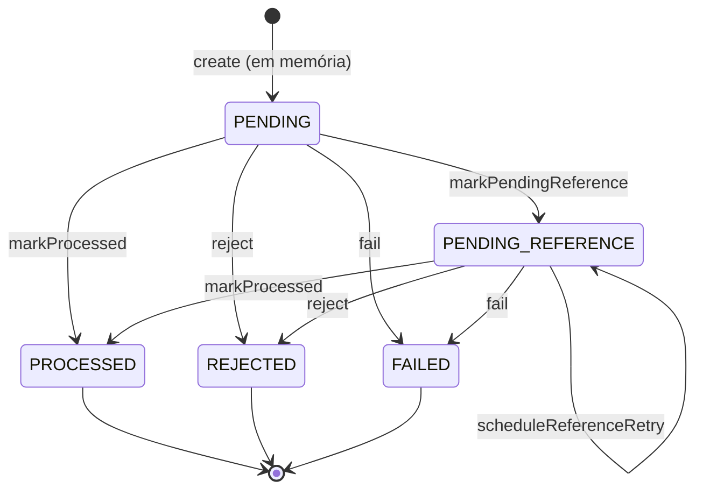

# Architecture

> Documento vivo: cada decisão é registrada no momento em que é tomada, durante o desenvolvimento.
>
> Formato de cada decisão:
> - **Decisão:**
> - **Alternativas consideradas:**
> - **Por que escolhi:**
> - **Trade-offs / limitações:**

## 1. Visão geral

<!-- Resumo do sistema, principais componentes e fluxo HTTP/SQS → use case → banco → outbox → publicação. -->

### 1.1 Stack e ferramentas

Versões em uso: Bun 1.4, TypeScript 7 (modo estrito), NestJS 12, MikroORM 7, PostgreSQL 17.

Antes de qualquer código de domínio, um spike validou que a stack funciona junta: NestJS subindo no Bun com injeção de dependências por decorators, MikroORM conectando no PostgreSQL, CLI de migrations rodando no Bun, migration reversível (`up`/`down`) e testes com `bun test`.

#### Adaptador HTTP do NestJS

- **Decisão:** Express.
- **Alternativas consideradas:** Fastify.
- **Por que escolhi:** é o adaptador padrão do NestJS. O gargalo deste sistema é o banco (locks e transações), não o framework HTTP, então o ganho de desempenho do Fastify não compensa.
- **Trade-offs / limitações:** menor throughput HTTP bruto que o Fastify.

#### Emulador de SQS

- **Decisão:** LocalStack com a versão fixada em `4.14.0`.
- **Alternativas consideradas:** LocalStack mais recente (2026.x) com `LOCALSTACK_AUTH_TOKEN`; MiniStack (alternativa open source citada no case).
- **Por que escolhi:** as versões atuais do LocalStack só sobem com token de licença, o que obrigaria qualquer pessoa que rode o projeto a criar uma conta. A `4.14.0` é a última que roda sem token. Optei pelo LocalStack por ser mais conhecido, por eu já ter experiência com ele (diferente do MiniStack) e por ser o primeiro citado no case.
- **Trade-offs / limitações:** a versão fica congelada, sem atualizações nem correções. Para um case técnico isso não é um problema, mas em um projeto que vai para produção o ideal seria usar as versões atuais. Se for preciso atualizar no futuro, basta trocar a imagem no `docker-compose.yml`.

#### Configuração

- **Decisão:** variáveis de ambiente lidas e validadas no boot por um loader tipado (`src/config/app-config.ts`), com valores padrão apontando para o ambiente local. Valor inválido ou ausente impede a aplicação de subir.
- **Alternativas consideradas:** `@nestjs/config`.
- **Por que escolhi:** poucas variáveis; um loader simples evita uma dependência e mantém a configuração tipada.
- **Trade-offs / limitações:** sem recursos como múltiplos arquivos `.env` por ambiente.

#### Execução das migrations

- **Decisão (provisória):** migrations rodam por comando separado (`bun run db:migrate`), não no boot da aplicação.
- **Alternativas consideradas:** rodar as migrations automaticamente ao subir a aplicação.
- **Por que escolhi:** com várias instâncias subindo ao mesmo tempo, todas tentariam migrar o banco simultaneamente.
- **Trade-offs / limitações:** exige um passo a mais no setup. A decisão pode ser revista quando a forma de rodar múltiplas instâncias for definida.

## 2. Estrutura do código e boundaries

- **Decisão:** DDD tático com portas e adaptadores (arquitetura hexagonal), organizado **por camada**.
- **Alternativas consideradas:**
  - CQRS formal (comandos, queries e handlers separados, `@nestjs/cqrs`);
  - versão mais leve, com use cases usando o `EntityManager` diretamente, sem interfaces de repositório;
  - organização por módulo (`wallet/`, `wagering/`), com camadas dentro de cada um.
- **Por que escolhi:** o case pede os padrões táticos do DDD (value object `Money`, aggregate root `Wallet`, entidades com transições explícitas, factories e `rehydrate`) e avalia "boundaries, portas e simplicidade". Portas e adaptadores mantêm o domínio isolado de NestJS e MikroORM sem acrescentar camadas que nenhuma regra exige, como o CQRS formal. DDD estratégico (bounded contexts, mapas de contexto) não se justifica em um sistema deste tamanho. A organização por camada foi preferida porque o use case central altera wallet, transação, ledger e outbox na mesma transação SQL: separar em módulos geraria imports cruzados constantes, sem uma fronteira real entre eles.
- **Trade-offs / limitações:** se o sistema crescesse para vários contextos independentes, a organização por módulo passaria a fazer mais sentido.

```
src/
  domain/          regras de negócio puras: Money, Wallet, WagerTransaction,
                   WalletLedgerEntry, Inbox/Outbox, eventos de integração, erros de domínio
  application/     use cases (orquestram uma transação SQL) e portas
                   (interfaces de repositórios, publisher, relógio etc.)
  infrastructure/  adaptadores: persistence (MikroORM), messaging (SQS),
                   http (controllers, health, auth), config
  main.ts, app.module.ts
```

**Regra de dependência:** `infrastructure → application → domain`. O domínio não importa nada de fora dele, nem `@nestjs/*`, nem `@mikro-orm/*`. A regra é verificada por um teste automático (`test/architecture.test.ts`), que falha se algum arquivo de `src/domain/` importar esses pacotes ou as outras camadas.

**Erros de domínio:** uma classe base abstrata `DomainError` carrega um `code: FailureCode` (seção 11.2), com uma subclasse por situação (ex.: `InvalidMoneyError` → `INVALID_MONEY`). A camada HTTP converte qualquer `DomainError` em resposta pelo `code`, sem conhecer cada erro. O `InvalidTransactionStateError` fica **fora** dessa hierarquia: é erro de programação, não regra de negócio, e resulta em 500.

**Testes:** os de unidade ficam ao lado do código (`*.test.ts` em `src/`); os de integração, concorrência e e2e, que precisam de infraestrutura rodando, ficam em `test/`.

## 3. Escopo e decisões de fora do escopo

Ficaram fora do escopo, por decisão, para concentrar o prazo nas áreas que mais pesam na avaliação (correção financeira, concorrência, idempotência e mensageria):

| Item | Status no case | Motivo |
|---|---|---|
| Autenticação real com IdP | Não pontua; pode ser só documentada | Ver seção 4 |
| Teste de carga | Diferencial opcional | Prazo |
| Ledger de partidas dobradas | Diferencial opcional | Prazo; o ledger simples atende às invariantes exigidas |
| OpenTelemetry / dashboard | Opcional | Prazo; logs estruturados, métricas e health checks cobrem o obrigatório |
| CI | Não pedido | Prazo |

## 4. Autenticação

- **Decisão:** não implementar autenticação neste desafio; deixar o ponto de extensão explícito no código.
- **Alternativas consideradas:** integrar um Identity Provider externo (Keycloak ou Zitadel) via OIDC.
- **Por que escolhi:** autenticação não vale pontos na avaliação e competiria em tempo com correção financeira, concorrência e idempotência, como o próprio case orienta.
- **Trade-offs / limitações:** a API fica aberta.

**Ponto de extensão no código:**
- `AuthGuard` (`src/auth/auth.guard.ts`), registrado como guard global: hoje libera todas as requisições. Uma implementação real validaria aqui o token emitido pelo IdP.
- Decorator `@Public()` (`src/auth/public.decorator.ts`): marca rotas que não exigem autenticação. Já aplicado aos health checks, que o case exige abertos.
- Mensagens da fila são tratadas como canal interno confiável, mas a identidade do provedor contida na mensagem continua sujeita às validações de domínio.

<!-- Desenho que seria adotado com um IdP externo: a definir. -->

## 5. Money

- **Decisão:** `bigint` em centavos no código e `numeric(20,2)` no banco, com entrada estrita de exatamente 2 casas decimais.
- **Alternativas consideradas:**
  - no código: biblioteca decimal (`decimal.js` / `big.js`);
  - no banco: coluna `bigint` com o valor em centavos.
- **Por que escolhi:**
  - `bigint` é nativo, exato para qualquer tamanho e não se mistura com `number` por acidente. Como a entrada tem exatamente 2 casas e as operações são somas, subtrações e comparações, não há necessidade de controle de arredondamento, então uma dependência como `decimal.js` não se justifica.
  - `numeric(20,2)` no banco é exato e mantém os valores legíveis em consultas, o que facilita auditoria e investigação de divergências. As constraints (`balance >= 0`) e a soma da reconciliação (`SUM`) também ficam exatas e claras.
  - A entrada estrita segue o case ("sempre com escala fixa de 2 casas") e garante uma única representação para cada valor. Assim, o mesmo valor nunca gera `payloadHash` diferentes por estar escrito de formas diferentes (`"25"`, `"25.0"`, `"25.00"`).
- **Regras de validação da entrada:** o formato aceito é apenas inteiro seguido de exatamente 2 casas decimais (ex.: `"25.00"`). São rejeitados: string vazia, notação científica (`"1e3"`), `NaN`, `Infinity`, sinal negativo, menos ou mais de 2 casas (`"25"`, `"25.5"`, `"25.001"`) e valores acima do máximo suportado.
- **Negativos:** a entrada nunca aceita valores negativos, mas o `Money` pode representá-los internamente (`negate()`, `isNegative()`), por exemplo como resultado de uma subtração. Quem garante que o saldo nunca fica negativo é a `Wallet` (e o banco, via constraint), não o `Money`.
- **Trade-offs / limitações:**
  - Exige conversão string ↔ `bigint` nas fronteiras (API e banco), porque JSON não suporta `bigint` e o driver retorna `numeric` como string.
  - A formatação para exibição é manual.
  - Escala fixa de 2 casas para todas as moedas: moedas com outra escala (ex.: JPY com 0, BHD com 3) não são suportadas. O case permite assumir uma única moeda (BRL); o modelo continua multimoeda e conflitos de moeda são rejeitados.
  - O `bigint` não tem limite, mas o `numeric(20,2)` tem. Por isso o `Money` valida um valor máximo, para que um valor grande demais seja rejeitado no domínio e não estoure no banco.
  - Se surgirem percentuais, juros ou rateio, será preciso implementar o arredondamento ou rever a decisão.

## 6. Modelo de domínio

### 6.1 Transições de status de `WagerTransaction`

- **Decisão:** `PENDING` existe apenas em memória. A transação nasce `PENDING` no `create` e é resolvida dentro da mesma transação SQL; no banco só aparecem `PROCESSED`, `REJECTED`, `PENDING_REFERENCE` e `FAILED`.
- **Alternativas consideradas:** gravar `PENDING` primeiro e processar em uma segunda transação SQL.
- **Por que escolhi:** HTTP e SQS executam o mesmo use case de forma síncrona, então não há trabalho "aceito para depois" além do `PENDING_REFERENCE`. Gravar `PENDING` criaria um estado intermediário que poderia ficar preso se o processo morresse entre as duas transações, exigindo um mecanismo extra de recuperação.
- **Trade-offs / limitações:** não há registro de transações que falharam por erro transitório antes do commit; elas simplesmente não existem até uma nova tentativa ter sucesso (ver `FAILED` abaixo para erros permanentes).



| De | Para | Método | Quando | O que registra |
|---|---|---|---|---|
| `PENDING` ou `PENDING_REFERENCE` | `PROCESSED` | `markProcessed(referenceTransactionId?, balanceAfter, at)` | Todas as regras de negócio passaram | `processedAt`, `resolvedAt`, `balanceAfter`, `referenceTransactionId` (quando há referência) |
| `PENDING` ou `PENDING_REFERENCE` | `REJECTED` | `reject(code, balanceAfter, at)` | Regra de negócio violada, ou tentativas de resolver a referência esgotadas | `failureCode`, `resolvedAt`, `balanceAfter` |
| `PENDING` ou `PENDING_REFERENCE` | `FAILED` | `fail(code, at)` | Erro permanente de infraestrutura (ver abaixo) | `failureCode`, `resolvedAt` |
| `PENDING` | `PENDING_REFERENCE` | `markPendingReference(...)` | A referência informada não foi encontrada | Contador de tentativas e data da próxima tentativa |
| `PENDING_REFERENCE` | (mesmo status) | `scheduleReferenceRetry(now)` | Nova tentativa do worker sem encontrar a referência | Incrementa o contador e recalcula a próxima tentativa |

**Transições inválidas** lançam `InvalidTransactionStateError` (erro de programação, não caminho de negócio):
- qualquer transição a partir de `PROCESSED`, `REJECTED` ou `FAILED` (estados terminais);
- `markPendingReference` em uma transação que já está em `PENDING_REFERENCE`;
- `scheduleReferenceRetry` fora de `PENDING_REFERENCE`.

**Campos registrados nas transições:**
- `processedAt`: preenchido somente ao virar `PROCESSED`, como no modelo do case.
- `resolvedAt`: preenchido por qualquer transição para um estado terminal, para que toda transação finalizada tenha data de auditoria. Por isso `reject` e `fail` recebem a data, o que o esqueleto do case não previa.
- `balanceAfter`: saldo observado no momento da resolução, preenchido em `PROCESSED` (saldo após a operação; em `LOSS`, o saldo inalterado) e em `REJECTED` (saldo no momento da rejeição). Vazio em `PENDING_REFERENCE` e `FAILED`. É a fonte do saldo devolvido no replay (regra 7); o ledger não serve para isso, porque `LOSS` e `REJECTED` não geram lançamento.
- `referenceTransactionId`: preenchido somente em `PROCESSED`. Em uma rejeição ligada à referência, o rastro fica no `referenceExternalTransactionId` (sempre gravado, vindo do payload) e no `failureCode`.
- Tentativas de resolução da referência (contador e próxima tentativa): ficam na própria transação, sem tabela separada. Limite e backoff: ver seção 14.

**Quando uma transação vira `FAILED`:**
- **Decisão:** apenas quando o erro é classificado como permanente (não é de negócio e uma nova tentativa não resolveria) ou, na entrada por SQS, na última tentativa antes da DLQ. Como a transação SQL do processamento sofreu rollback, o `FAILED` é gravado em uma transação SQL separada.
- **Alternativas consideradas:** nunca gravar `FAILED` (deixando a DLQ como único registro); gravar `FAILED` em qualquer erro de infraestrutura.
- **Por que escolhi:** dá ao status um uso real e auditável sem "queimar" transações por instabilidades passageiras, que são tratadas com retry (503 na API, redelivery no SQS).
- **Trade-offs / limitações:** a transação `FAILED` mantém a idempotency key; repetir a mesma operação devolve `FAILED`, e o provedor precisa de uma nova key para tentar de novo.

### 6.2 Interpretações adicionais das regras de negócio

- **Inválido × rejeitado.** O que pode ser verificado apenas olhando o payload (campos ausentes, formato do `Money`, `kind` inexistente, `OPENING` vindo de fora, `Idempotency-Key` ausente, `REFUND`/`ROLLBACK` sem `referenceExternalTransactionId`) é **inválido**: responde 400 e nada é gravado. O que depende do estado no banco (saldo insuficiente, moeda diferente da wallet, referência de outro player/rodada, reversão duplicada, reversão que deixaria saldo negativo) é **rejeitado**: gravado como `REJECTED`, com `failureCode`, auditável e repetível. Payload inválido não tem estado a auditar e o provedor corrige o payload; rejeição precisa devolver sempre a mesma resposta (regra 7).
- **Referência ausente vale para qualquer tipo.** A regra 8 não distingue tipos: qualquer transação que informa `referenceExternalTransactionId` não encontrada vai para `PENDING_REFERENCE`, inclusive `WIN`. Ignorar uma referência informada pularia as validações da regra 2 (mesmo provider, player, wallet, moeda e rodada). Um `WIN` sem referência é processado normalmente.
- **Replay de transação pendente.** A regra 7 fala de operação já processada. Para uma transação que está (ou esteve) em `PENDING_REFERENCE`, o replay devolve o **estado atual** com `idempotentReplay: true`: 202 enquanto pendente; o resultado final (com o `balanceAfter` gravado) depois de resolvida. Assim o provedor pode repetir a chamada para saber o desfecho.
- **`OPENING`.** Segue o mesmo ciclo (`PENDING` → `PROCESSED`), na mesma transação SQL que cria a wallet, e nunca é rejeitada nem fica pendente. Por ser interna, não tem campos de provedor (`providerId`, `externalTransactionId`, `idempotencyKey`, `roundId`, `gameId`): essas colunas aceitam nulo **somente** quando `kind = 'OPENING'`, garantido por `CHECK` no banco, e um índice único garante no máximo um `OPENING` por wallet. Alternativa descartada: valores reservados (ex.: `providerId = "system"`), que exigiriam bloquear esses valores na API e criariam um provedor fictício.
- **Wallet inexistente não é gravada.** Exceção à regra "o que depende do banco é gravado": a transação referencia a wallet por chave estrangeira, então não é possível gravá-la apontando para uma wallet que não existe. A resposta é 422 `WALLET_NOT_FOUND`, sem gravação; sem wallet não há estado a auditar, e a integridade referencial no banco é preservada. Já uma wallet existente que não pertence ao `playerId` informado gera `REJECTED` com `PLAYER_WALLET_MISMATCH`.
- **Referência que não está `PROCESSED`.** A regra 3 exige que a referência seja `PROCESSED`. Se ela existe em qualquer outro estado (`REJECTED`, `FAILED` ou `PENDING_REFERENCE`), a nova transação é rejeitada com `REFERENCE_NOT_PROCESSED`, sem espera. Ver limitação na seção 18.
- **Reversão única no total.** A regra 4 diz que uma referência não pode ser revertida duas vezes "pelo mesmo tipo de operação". Lida literalmente, uma `BET` poderia receber um `REFUND` e um `ROLLBACK`, creditando o valor duas vezes, o que viola a invariante global de não duplicar créditos. Por isso, uma transação só pode ser revertida **uma vez no total**, por `REFUND` ou `ROLLBACK`; a segunda tentativa é rejeitada com `ALREADY_REVERSED`. Um `ROLLBACK` de um `REFUND` continua permitido, porque reverte outra transação. No banco, a unicidade é garantida por um índice único sobre a referência (não sobre referência + tipo) entre as reversões processadas.

## 7. ORM e mapeamento de persistência

### 7.1 Escolha do ORM

- **Decisão:** MikroORM.
- **Alternativas consideradas:** TypeORM (aceito pelo case).
- **Por que escolhi:** é o preferencial do case e oferece Unit of Work, Identity Map, `em.transactional()` e `LockMode` explícitos, recursos diretamente ligados às exigências de atomicidade e concorrência.
- **Trade-offs / limitações:** <!-- a definir -->

### 7.2 Mapeamento domínio × ORM

- **Decisão:** modelos de persistência separados (`defineEntity` sem classe própria, com tipos inferidos) mais um mapper por agregado, que converte a linha do banco no `State` do domínio e usa o `rehydrate`. O Unit of Work continua em uso, só que sobre os modelos de persistência:
  - Agregado novo: o repositório faz `em.create` e `persist`.
  - Agregado alterado: o repositório pega a entidade gerenciada pelo identity map do `EntityManager` da requisição e aplica o estado do domínio com `em.assign`. O `flush` gera o `UPDATE` só das colunas que mudaram.
  - A atomicidade vem de `em.transactional`.
- **Alternativas consideradas:**
  - Mapear as classes de domínio direto no ORM (`defineEntity({ class })` ou `EntitySchema`): menos código, mas o ORM passa a determinar a forma das classes de domínio, e o construtor privado exige um cast por entidade.
  - Repositórios sem Unit of Work (`insert`/`nativeUpdate` explícitos): SQL totalmente visível, mas mais código de repositório.
- **Por que escolhi:**
  - O domínio já expõe `rehydrate(state)`, então o mapper é uma conversão direta.
  - O domínio fica livre do ORM, inclusive em forma, não só em imports.
  - O `defineEntity` é usado na forma recomendada, com inferência completa.
  - A conversão de `Money` fica explícita e testável.
  - É um padrão que já conheço.
- **Trade-offs:**
  - Cada agregado tem duas definições (domínio e persistência) mais um mapper.
  - Uma mudança em campo persistido exige ajustar o mapper.
  - A `version` da `Wallet` é incrementada pelo domínio e persistida como uma coluna comum, sem `version: true`, para não ser incrementada duas vezes. Como ela participa do controle de concorrência é decidido na etapa 4 (seção 9).

**Observação do spike:** uma classe com construtor `private` e sem decorators pode ser mapeada via `EntitySchema`. Em runtime funciona (o ORM reidrata sem chamar o construtor), mas o TypeScript recusa o construtor privado no `EntitySchema`, o que exige um cast (`as unknown as EntityCtor<T>`) em cada entidade. Esse foi um dos motivos para usar modelos separados.

**Repositórios:** os ports ficam em `src/application/ports` e os adapters em `src/infrastructure/persistence/<agregado>`. O `save` só registra a mudança no Unit of Work; quem faz o `flush` é a transação do caso de uso. Um agregado carregado por outro `EntityManager` seria tratado como novo, e o banco recusaria a chave duplicada; com um `EntityManager` por requisição ou mensagem, isso não acontece.

**Mapeamento do Money:** ver seção 5. A coluna `numeric(20,2)` é lida como string decimal (`"75.00"`) e convertida por `Money.from`; na escrita, o mapper usa `money.toJSON().amount`. Não há `number` em nenhum ponto do caminho.

<!-- Estratégia transacional: a definir. -->

## 8. Schema, constraints e índices

A restrição 9 exige que unicidade, imutabilidade e não-negatividade sejam garantidas no schema, não só no código. Cada regra que o domínio aplica tem um equivalente no banco: um bug num mapper ou num caso de uso vira erro de banco em vez de dado inconsistente.

### 8.1 Convenções

- **Decisão:**
  - Constraints, índices e triggers são declarados nos metadados do `defineEntity`, e as migrations são geradas por diff (`migration:create`).
  - Toda constraint e todo índice têm **nome explícito**, no padrão `<tabela>_<garantia>_<tipo>`.
  - Enums são `text` com `CHECK (col IN (...))`. As listas de `kind`, `status`, `failure_code` e `direction` vêm dos enums do domínio, então um valor novo aparece no diff e gera migration.
  - Ids internos são `uuid`. Campos vindos do provedor e `player_id` são `text` com `CHECK` de tamanho entre 1 e 255. Hashes são `char(64)` com `CHECK` de hexadecimal minúsculo. Valores em dinheiro são `numeric(20,2)`, com uma coluna `currency` por linha, compartilhada por todos os valores daquela linha.
  - Chaves estrangeiras são sempre `RESTRICT`: nada financeiro é apagado ou alterado em cascata.
  - Uma migration por agregado.
- **Alternativas consideradas:**
  - SQL escrito à mão nas migrations, com as entidades descrevendo só as colunas.
  - Enum nativo do Postgres (`CREATE TYPE`).
  - `varchar(255)`, o padrão do ORM.
- **Por que escolhi:**
  - Com tudo nos metadados, a definição completa da tabela fica num lugar só, e o diff não tenta remover o que foi escrito à mão.
  - O nome explícito vira contrato: o repositório traduz uma violação de unicidade em erro de domínio pelo nome da constraint. Por exemplo, `wager_transaction_provider_idempotency_key_unique` vira replay ou `IDEMPOTENCY_CONFLICT`, e `wager_transaction_provider_external_id_unique` vira `EXTERNAL_TRANSACTION_CONFLICT`. Com dois `UNIQUE` na mesma tabela, distinguir qual foi violado é obrigatório.
  - Num enum nativo, remover um valor no `down` exige recriar o tipo. Com `text` + `CHECK`, basta trocar o `CHECK`.
  - No Postgres, `text` e `varchar(n)` têm o mesmo desempenho, e o `CHECK` também barra string vazia.
- **Trade-offs:** duas exceções ao "tudo nos metadados", descritas na 8.4.

### 8.2 Garantias por tabela

**`wallet`**

| Garantia | Mecanismo |
|---|---|
| No máximo uma wallet por jogador e moeda | `wallet_player_currency_unique` |
| Saldo nunca negativo | `wallet_balance_non_negative_check` |
| `version` começa em 1 | `wallet_version_positive_check` |
| Moeda ISO-4217 | `char(3)` + `wallet_currency_format_check` |
| Alvo da FK de moeda do ledger | `wallet_id_currency_unique` |

**`wager_transaction`**

| Garantia | Mecanismo |
|---|---|
| Idempotency key única por provedor | `wager_transaction_provider_idempotency_key_unique` |
| Id externo único por provedor (é como a referência é resolvida) | `wager_transaction_provider_external_id_unique` |
| No máximo uma `OPENING` por wallet | índice único parcial `wager_transaction_opening_per_wallet_unique` |
| Uma transação é revertida uma única vez, por `REFUND` ou `ROLLBACK` | índice único parcial `wager_transaction_single_reversal_unique` sobre `reference_transaction_id`, entre reversões `PROCESSED` |
| `PENDING` nunca é persistido | `wager_transaction_status_check` |
| Valor positivo; saldo após não negativo | `wager_transaction_amount_positive_check`, `wager_transaction_balance_after_non_negative_check` |
| Coerência entre status e colunas | um `CHECK` por regra: `failure_code` ⇔ `REJECTED`/`FAILED`; `resolved_at` ⇔ terminal; `processed_at` ⇔ `PROCESSED`; `reference_transaction_id` ⇒ `PROCESSED`; `next_reference_attempt_at` ⇔ `PENDING_REFERENCE`; `balance_after` ⇔ `PROCESSED`, ou `REJECTED` com código diferente de `CURRENCY_MISMATCH` |
| Coerência entre tipo e colunas | `REFUND`/`ROLLBACK` exigem `reference_external_transaction_id`; `payload_hash` ⇔ não `OPENING`; os 5 campos de provedor são todos nulos (`OPENING`) ou todos preenchidos |
| Wallet e referência existem | FKs `wallet_id` e `reference_transaction_id` (esta para a própria tabela) |
| Linha terminal não muda; nenhuma linha é apagada | trigger `wager_transaction_terminal_immutable` |

Não há FK de `player_id` nem de `currency` para a wallet: `PLAYER_WALLET_MISMATCH` e `CURRENCY_MISMATCH` precisam gravar um `REJECTED` com os valores divergentes. Pelo mesmo motivo, numa rejeição por `CURRENCY_MISMATCH` o `balance_after` fica nulo: o saldo da wallet está em outra moeda, e a linha tem uma única coluna de moeda. O domínio aplica a mesma regra em `reject`, e o evento `WagerTransactionRejected` omite o campo nesse caso.

**`wallet_ledger_entry`**

| Garantia | Mecanismo |
|---|---|
| No máximo um lançamento por wallet e transação | `wallet_ledger_entry_wallet_transaction_unique` |
| Lançamento balanceado: `balance_after = balance_before ± amount` | `wallet_ledger_entry_balanced_check` (o `isBalanced()` do domínio, no banco) |
| Valor positivo; saldos não negativos | `..._amount_positive_check`, `..._balance_before_non_negative_check`, `..._balance_after_non_negative_check` |
| Moeda do lançamento = moeda da wallet | FK composta `(wallet_id, currency) → wallet (id, currency)` |
| Transação existe | FK `transaction_id` |
| Append-only | triggers que bloqueiam `UPDATE`, `DELETE` e `TRUNCATE` |

**`outbox_message`:** chave primária `id` (= `eventId`, uma linha por evento), `payload` em `jsonb` (o JSON é validado na escrita), `attempts >= 0`, `event_type` não vazio.

**`inbox_message`:** chave primária `(consumer_name, message_id)`, que é a deduplicação, e `CHECK` de formato do `payload_hash`.

**Índices de consulta:** cada um atende a uma consulta que existe.
- `wager_transaction_wallet_id_index`: consultas por wallet.
- `wager_transaction_pending_reference_index`: parcial, só com as linhas em `PENDING_REFERENCE`, para o worker de reprocessamento.
- `wallet_ledger_entry_wallet_created_at_index`: histórico, reconciliação e replay.
- `outbox_message_pending_index`: parcial, só com as mensagens não publicadas, para o publisher.

As buscas por idempotency key e por id externo usam os índices dos próprios `UNIQUE`.

### 8.3 Imutabilidade

- **Decisão:**
  - O ledger é append-only. Triggers `BEFORE UPDATE OR DELETE` (por linha) e `BEFORE TRUNCATE` (por statement) lançam exceção.
  - Em `wager_transaction`, um trigger bloqueia qualquer `DELETE` e qualquer `UPDATE` numa linha terminal. A única transição de uma linha persistida é `PENDING_REFERENCE` → terminal.
- **Alternativas consideradas:** `REVOKE UPDATE, DELETE` para um role de banco separado da aplicação.
- **Por que escolhi:** funciona com o usuário único do Compose e é fácil de testar. O trigger de `wager_transaction` protege o histórico auditável que é a resposta do replay.
- **Trade-offs:** um superusuário pode desabilitar o trigger. Em produção, o `REVOKE` com roles separados (um para migrations, outro para a aplicação) seria uma camada a mais.

### 8.4 Como as migrations são geradas

O caminho normal é declarar no `defineEntity`, rodar `migration:create` e conferir o `down`. Quatro situações saem desse caminho:

- **FK composta da moeda do ledger, escrita à mão na migration.** As relações do MikroORM só apontam para a chave primária do alvo (o `targetKey` aceita uma única coluna com `UNIQUE` próprio), e esta aponta para `wallet (id, currency)`. O teste de schema prova que ela existe.
- **FK de `reference_transaction_id` para a própria tabela.** Uma entidade não pode referenciar a si mesma dentro do próprio `defineEntity`: o TypeScript não infere o tipo e, em runtime, a constante ainda não existe. A FK é declarada logo depois, com `addManyToOne`, e continua nos metadados.
- **Snapshot fixo e desacoplado do banco** (`snapshotOnMigrate: false`, `snapshotName: '.snapshot-wagering'`). Com o padrão, depois de cada `migrate` o snapshot é reescrito a partir do banco real. Essa leitura não enxerga triggers de statement (`TRUNCATE`) e enxerga a FK manual, então o diff seguinte propunha remover a FK e recriar o trigger. O nome padrão do snapshot também depende do nome do banco, e o teste de reversibilidade, que usa outro banco, acusava diferenças falsas. O snapshot é versionado junto com as migrations.
- **Expressões de `CHECK` na forma em que o Postgres as devolve.** O Postgres reescreve algumas expressões (`between 1 and 255` volta como `>= 1 AND <= 255`), e o diff compara texto. As expressões já são escritas na forma normalizada. O `migration:check` do teste de reversibilidade pega qualquer caso novo.

A migration gerada com `--initial` não inclui `down`, por isso não é usada: todas as migrations são geradas por diff.

### 8.5 Testes de schema

- **Por garantia:** um teste com SQL direto, passando por fora do domínio, tenta violar cada garantia e confere o **nome** da constraint ou a mensagem do trigger. A linha de teste é válida em tudo, exceto no ponto testado, para que o teste falhe pelo motivo certo. O Postgres avalia os `CHECK` em ordem alfabética de nome, e uma linha mal montada é barrada por outro `CHECK`.
  - Em consequência, o `wallet_ledger_entry_direction_check` é redundante: uma direção desconhecida nunca fecha a aritmética, e o `balanced_check` a barra antes. Ele foi mantido como documentação explícita.
- **Reversibilidade:** num banco temporário, o teste aplica todas as migrations, desfaz até zero, aplica de novo e confirma que o `checkSchema` não aponta diferença.

### 8.6 Fora do escopo

- **Invariantes entre tabelas verificadas no commit** (`CONSTRAINT TRIGGER ... DEFERRABLE INITIALLY DEFERRED`): "lançamento só para transação `PROCESSED` e diferente de `LOSS`" e "toda mudança de `wallet.balance` tem um lançamento com `balance_after = NEW.balance`". Ficam cobertas por testes de integração e pela reconciliação (seção 15). São difíceis de depurar e arriscadas de acertar no prazo, e a restrição 9 já está atendida.
- **FK composta `(transaction_id, wallet_id)` no ledger,** que garantiria que o lançamento aponta para uma transação da mesma wallet. Descartada para manter só a FK composta da moeda.
- **`REVOKE` por role de banco** (ver 8.3).

## 9. Concorrência

## 10. Idempotência

<!-- Fluxo, replay, conflito, algoritmo do payloadHash. -->

## 11. API HTTP

### 11.1 Mapeamento de status HTTP

### 11.2 Taxonomia de `failureCode`

- **Decisão:** códigos em inglês, `UPPER_SNAKE_CASE`, definidos em um enum. Um código publicado nunca muda de significado. Cada código pertence a uma categoria fixa, e a categoria é comunicada pelo status HTTP. Há uma lista única para todas as respostas de erro da API; apenas os códigos de `REJECTED` e `FAILED` ficam gravados na transação.
- **Alternativas consideradas:** códigos numéricos (`E1001`); campo `retryable` na resposta; `failureCode` apenas para transações gravadas, com os demais erros respondendo só com mensagem.
- **Por que escolhi:** códigos textuais se explicam sozinhos em logs e no JSON, e o enum impede códigos fora da lista em tempo de compilação. O status HTTP já distingue as categorias (exigência do case), então um campo `retryable` seria redundante e poderia contradizê-lo. Uma lista única permite ao provedor decidir o que fazer com qualquer erro sem interpretar mensagens.
- **Trade-offs / limitações:** adicionar um código é compatível; mudar o significado de um existente não é, e exigiria um código novo.

> Os status HTTP abaixo indicam a categoria; o mapeamento definitivo é documentado na seção 11.1.

| Categoria | O que o provedor faz | HTTP | Gravado? | Códigos |
|---|---|---|---|---|
| Payload inválido | Corrige o payload | 400 | Não | `INVALID_PAYLOAD`, `INVALID_MONEY`, `INVALID_KIND`, `MISSING_REFERENCE`, `MISSING_IDEMPOTENCY_KEY` |
| Conflito | Não repete a requisição | 409 | Não | `IDEMPOTENCY_CONFLICT`, `EXTERNAL_TRANSACTION_CONFLICT`, `WALLET_ALREADY_EXISTS` |
| Não encontrado | Corrige o identificador | 404 (recurso da URL) / 422 (citado no corpo) | Não | `WALLET_NOT_FOUND`, `TRANSACTION_NOT_FOUND` |
| Rejeição de negócio | Desiste ou corrige | 422 | Sim (`REJECTED`) | `INSUFFICIENT_FUNDS`, `REVERSAL_INSUFFICIENT_FUNDS`, `CURRENCY_MISMATCH`, `PLAYER_WALLET_MISMATCH`, `REFERENCE_NOT_FOUND`, `REFERENCE_MISMATCH`, `INVALID_REFERENCE_KIND`, `REFERENCE_NOT_PROCESSED`, `ALREADY_REVERSED`, `AMOUNT_MISMATCH` |
| Falha transitória | Reenvia (com backoff) | 503 | Não | `TEMPORARILY_UNAVAILABLE` |
| Falha permanente | Investiga; reenviar com a mesma key devolve o mesmo resultado | 500 | Sim (`FAILED`) | `PROCESSING_FAILED` |

| Código | Significado |
|---|---|
| `INVALID_PAYLOAD` | Campo obrigatório ausente ou com tipo inválido |
| `INVALID_MONEY` | Valor monetário fora do formato (escala diferente de 2 casas, notação científica, negativo, `NaN`, `Infinity`, vazio ou acima do máximo) |
| `INVALID_KIND` | Tipo de operação inexistente, ou `OPENING` submetido externamente |
| `MISSING_REFERENCE` | `REFUND` ou `ROLLBACK` sem `referenceExternalTransactionId` |
| `MISSING_IDEMPOTENCY_KEY` | Header `Idempotency-Key` ausente |
| `IDEMPOTENCY_CONFLICT` | Mesma idempotency key com payload diferente |
| `EXTERNAL_TRANSACTION_CONFLICT` | Mesmo `(providerId, externalTransactionId)` de uma transação existente, com outra idempotency key |
| `WALLET_ALREADY_EXISTS` | Já existe wallet para o mesmo `playerId` + `currency` |
| `WALLET_NOT_FOUND` | Wallet inexistente |
| `TRANSACTION_NOT_FOUND` | Transação inexistente |
| `INSUFFICIENT_FUNDS` | Aposta (`BET`) sem saldo suficiente |
| `REVERSAL_INSUFFICIENT_FUNDS` | Reversão que deixaria o saldo negativo (distinto de `INSUFFICIENT_FUNDS`, como exige a regra 9) |
| `CURRENCY_MISMATCH` | Moeda da operação diferente da moeda da wallet |
| `PLAYER_WALLET_MISMATCH` | A wallet existe, mas não pertence ao `playerId` informado |
| `REFERENCE_NOT_FOUND` | Referência não encontrada após esgotar as tentativas de `PENDING_REFERENCE` |
| `REFERENCE_MISMATCH` | Referência de outro provider, player, wallet, moeda ou rodada (o campo divergente vai para o log) |
| `INVALID_REFERENCE_KIND` | Tipo de referência não permitido (`REFUND` só referencia `BET`; `ROLLBACK` só referencia `BET`, `WIN` ou `REFUND`) |
| `REFERENCE_NOT_PROCESSED` | A referência existe, mas não está `PROCESSED` |
| `ALREADY_REVERSED` | A referência já foi revertida (por `REFUND` ou `ROLLBACK`) |
| `AMOUNT_MISMATCH` | Valor da reversão diferente do valor da referência |
| `TEMPORARILY_UNAVAILABLE` | Banco ou fila indisponível, ou timeout de lock |
| `PROCESSING_FAILED` | Erro permanente de infraestrutura; transação gravada como `FAILED` |

## 12. Processamento por SQS

### 12.1 Inbox

- **Decisão:** deduplicação persistente por `(consumerName, messageId)`, gravada na mesma transação SQL da alteração financeira. O inbox guarda o `payloadHash` da mensagem, calculado com o **mesmo algoritmo do `payloadHash` da transação** (seção 10) sobre os campos de negócio do `data`.
- **Alternativas consideradas:** hash do corpo inteiro da mensagem; deduplicar apenas pela idempotency key da transação.
- **Por que escolhi:** um único algoritmo de hash no sistema, que não depende de metadados de transporte (como o `occurredAt` do envelope). O inbox protege contra a reentrega da **mensagem**; a idempotency key protege contra a repetição da **operação**. São camadas diferentes, e o case exige as duas.
- **Trade-offs / limitações:** <!-- a definir -->

**Mesmo `messageId` com conteúdo diferente:** tratado como erro permanente (logado, contabilizado em métrica e enviado para a DLQ), sem processar. É um erro do produtor; processar uma das duas versões seria uma escolha arbitrária.

<!-- Ack, classificação de erros, retry, DLQ e shutdown: a definir na etapa 6. -->

## 13. Transactional Outbox

### 13.1 Eventos de integração

- **Decisão:** os eventos ficam no domínio (`src/domain/events/`), como subclasses de uma classe abstrata `IntegrationEvent`, com `eventType` e `version` definidos em cada subclasse. Identidade, rastreio e data (`eventId`, `correlationId`, `causationId`, `occurredAt`) chegam em um `EventContext` montado pela aplicação.
- **Alternativas consideradas:** eventos na camada de aplicação, tratando o contrato público como algo fora do domínio.
- **Por que escolhi:** segue o esqueleto do case, que constrói os eventos a partir de objetos de domínio (`WalletBalanceChanged.from(wallet, entry, ctx)`). As classes são TypeScript puro, e o teste de arquitetura garante que não dependem de framework. Receber ids e datas de fora mantém o domínio determinístico, como no restante do modelo.
- **Trade-offs / limitações:** o contrato público fica no mesmo pacote do modelo interno; mudanças no domínio precisam cuidar para não alterar o JSON publicado sem incrementar a `version`.

**`data` sempre em JSON estável:** valores monetários como `MoneyProps` (string decimal), datas em ISO-8601, nunca instâncias de `Money` ou `Date`. O `data` é congelado na criação do evento.

**`aggregateId`:** a entidade natural de cada evento: o `transactionId` nos eventos de transação e o `walletId` no `WalletBalanceChanged`. O `walletId` vai sempre no `data`. A ordenação por wallet na fila é uma decisão separada (seção 13.2).

| Evento | Quando | `data` |
|---|---|---|
| `WagerTransactionProcessed` | Qualquer transação aplicada, inclusive `LOSS` e `OPENING` | `transactionId`, `walletId`, `playerId`, `kind`, `money`, `balanceAfter`, `referenceTransactionId?`, `processedAt` + dados do provedor |
| `WagerTransactionRejected` | Rejeição por regra de negócio (inclusive tentativas esgotadas de `PENDING_REFERENCE`) | `transactionId`, `walletId`, `playerId`, `kind`, `money`, `failureCode`, `balanceAfter`, `rejectedAt` + dados do provedor |
| `WagerTransactionPendingReference` | Uma única vez, quando a transação entra em `PENDING_REFERENCE` | `transactionId`, `walletId`, `playerId`, `kind`, `money`, `referenceExternalTransactionId` + dados do provedor |
| `WalletBalanceChanged` | Somente quando o saldo muda (um por lançamento no ledger), inclusive na abertura | `walletId`, `transactionId`, `direction`, `money`, `balanceBefore`, `balanceAfter`, `walletVersion` |

"Dados do provedor" são `providerId`, `externalTransactionId`, `roundId` e `gameId`; ausentes apenas na `OPENING`. A idempotency key não é publicada (é detalhe de transporte). Cada evento carrega o necessário para o consumidor agir sem consultar a API de volta.

**Decisões sobre quando emitir:**
- **`OPENING` emite `WagerTransactionProcessed` e `WalletBalanceChanged`:** ela é uma transação aplicada e altera o saldo; quem acompanha saldos precisa conhecer o saldo inicial.
- **`PENDING_REFERENCE` emite só na entrada:** o fato de negócio ("aguardando referência") acontece uma vez. As novas tentativas são detalhe operacional e aparecem nas métricas; o desfecho chega por `Processed` ou `Rejected`.
- **`FAILED` não emite evento:** não está entre os eventos mínimos do case e é uma falha operacional, não um fato de negócio. Fica registrada em logs, métricas e DLQ. Um evento novo pode ser adicionado no futuro sem quebrar os contratos existentes.

**Validações na construção dos eventos (erros de programação, `InvariantViolationError`):**
- cada evento de transação exige o status correspondente (`PROCESSED`, `REJECTED` ou `PENDING_REFERENCE`);
- o `WalletBalanceChanged` exige que o lançamento seja da própria wallet e seja a movimentação mais recente dela, garantindo que o evento é montado logo após a movimentação, com a `walletVersion` correta.

### 13.2 Outbox

- **Decisão:** o evento é gravado como `OutboxMessage` na mesma transação SQL da alteração financeira, e publicado por um worker depois do commit. O `id` da mensagem é o próprio `eventId` (uma linha por evento), e o payload é o `event.toJSON()`. A mensagem nasce com `attempts = 0` e sem `nextAttemptAt`, ou seja, pronta para publicação imediata.
- **Alternativas consideradas:** publicar direto no SQS após o commit, sem outbox.
- **Por que escolhi:** publicar antes do commit é eliminatório (o sistema anunciaria algo que pode sofrer rollback); publicar após o commit sem outbox perde o evento se o processo morrer entre o commit e a publicação. Usar o `eventId` como id deixa a mesma chave de deduplicação em toda a cadeia: outbox, mensagem publicada e consumidor.
- **Trade-offs / limitações:** a entrega é *at-least-once*: um evento pode ser publicado mais de uma vez (por exemplo, se o processo morrer depois de publicar e antes de marcar como publicado). Os consumidores precisam deduplicar pelo `eventId`.

**Retry com backoff exponencial:**
- **Decisão:** `scheduleRetry(now)` incrementa `attempts` e agenda a próxima tentativa com backoff exponencial sem jitter: 1 s, 2 s, 4 s... até um teto de 60 s. O cálculo fica em uma função pura do domínio, `computeBackoffDelay(attempt, baseMs, maxMs)`, reaproveitada pelo worker de `PENDING_REFERENCE` (seção 14). Os valores são constantes no `OutboxMessage` e podem ser revistos junto com o publisher.
- **Alternativas consideradas:** um objeto de política de backoff injetável; jitter (variação aleatória) no domínio.
- **Por que escolhi:** mantém a assinatura do esqueleto do case (`scheduleRetry(now)`) com a fórmula em um único lugar. Sem jitter, o cálculo é determinístico e testável; se necessário, o jitter pode ser aplicado pelo publisher.
- **Trade-offs / limitações:** sem jitter, várias instâncias que falharam ao mesmo tempo tentam de novo ao mesmo tempo.

**O outbox nunca desiste:**
- **Decisão:** não há limite de tentativas; o atraso cresce até o teto e permanece nele.
- **Alternativas consideradas:** desistir após N tentativas e marcar o evento como falho.
- **Por que escolhi:** o case exige não perder eventos confirmados; descartar após N tentativas seria exatamente isso. Uma indisponibilidade longa do SQS se resolve quando ele volta.
- **Trade-offs / limitações:** um evento que nunca consegue ser publicado fica pendente indefinidamente. A métrica de *outbox lag* (idade do evento pendente mais antigo) é o alarme para esse caso.

<!-- Publicação concorrente (múltiplos publishers), destino dos eventos e MessageGroupId: a definir na etapa 7. -->

## 14. Referências fora de ordem (`PENDING_REFERENCE`)

## 15. Reconciliação

## 16. Observabilidade

### 16.1 Logs estruturados

- **Decisão:** `pino` via `nestjs-pino`, com saída em JSON.
- **Alternativas consideradas:** `winston`; estender o logger nativo do NestJS para gerar JSON.
- **Por que escolhi:** JSON nativo; o `nestjs-pino` propaga o contexto da requisição (via `AsyncLocalStorage`) para todos os logs gerados durante ela, sem passar o logger manualmente.
- **Trade-offs / limitações:** a saída em JSON é pouco legível no terminal durante o desenvolvimento (pode ser contornado com `pino-pretty`, não incluído).

**Como está configurado:**
- **`correlationId`:** reutiliza o header `x-correlation-id` da requisição, ou gera um UUID. É devolvido no mesmo header da resposta e aparece em todos os logs da requisição.
- **Sem dados sensíveis:** o log da requisição registra só método e URL, e o da resposta só o status. Headers `authorization` e `cookie` são removidos (`redact`), e corpos de requisição e resposta (payloads financeiros) não são logados.
- Requisições aos health checks não geram log de acesso, para não poluir os logs com as sondagens.

<!-- messageId, transactionId, walletId, providerId: a adicionar com o use case e o consumidor SQS. -->

### 16.2 Health checks

- `GET /health/live`: indica que o processo está de pé e respondendo. Não consulta dependências, para que uma falha no banco ou na fila não faça o orquestrador reiniciar o processo à toa.
- `GET /health/ready`: verifica o PostgreSQL (`select 1`) e o SQS (`GetQueueUrl` da fila principal), cada um com timeout de 2 s. Responde 200 se ambos estiverem acessíveis e 503 caso contrário, indicando qual dependência falhou. O motivo da falha é registrado no log.
- Os dois são públicos (`@Public()`), como o case exige.

### 16.3 Métricas

<!-- A definir. -->

## 17. Testes

<!-- Estratégia, como cada cenário obrigatório é exercitado, determinismo. -->

## 18. Trade-offs e limitações conhecidas

- **Reversão de transação ainda pendente.** Uma reversão que chega enquanto a transação referenciada está em `PENDING_REFERENCE` é rejeitada com `REFERENCE_NOT_PROCESSED`, em vez de aguardar a resolução da referência. Encadear pendências não é exigido pelo case e adicionaria complexidade ao worker; o caso é raro (exige duas operações fora de ordem em sequência).

## 19. Uso de IA

<!-- Para que foi usada e como o conteúdo foi validado. -->
